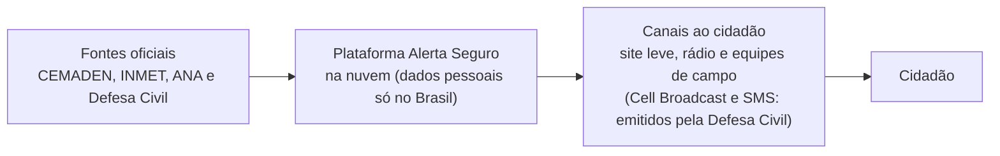
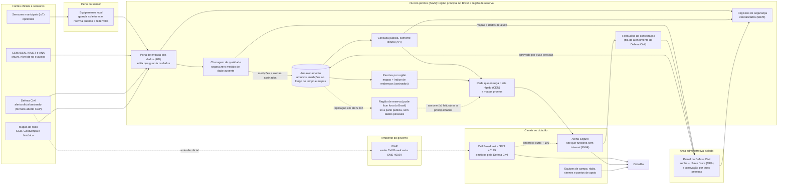

# Alerta Seguro: informação por endereço e orientação de ação para alertas de chuva intensa em áreas de várzea e de encosta de São Paulo

## Integrantes

| Nome completo (ordem alfabética) | GitHub | Área de carreira | RGM |
|---|---|---|---|
| Alessandra Guimarães da Silva | @Allessandra02 | Cibersegurança | 47918772 |
| Davi Pereira de Oliveira Silva | @Davi-Pereira2z | Cloud Computing | 47857013 |
| Ellen Cristina Soares de Jesus | @Ellen-Soares | Cloud Computing | 47795387 |
| Samuel Guimarães da Silva | @Samuel-Guimaraes345 | Cloud Computing | 48039501 |

**Dossiê:** 8 – Alertas climáticos e infraestrutura resiliente

**Recorte:** alertas de chuva intensa (alagamentos, inundações e deslizamentos), com um módulo informativo sobre calor extremo; piloto na cidade de São Paulo (áreas de várzea e de encosta), com arquitetura nacional replicável. A justificativa está na seção 1.1.

## 1. Análise do problema

> **Em resumo:** para um alerta de chuva funcionar, várias etapas precisam dar certo em sequência. Hoje o aviso muitas vezes chega sem dizer qual rua está em risco, para onde ir e a quem pedir ajuda, e algumas pessoas nem chegam a recebê-lo. A proposta ocupa esse "último metro" entre o alerta e a ação.

### 1.1 Quem é afetado, onde e quanto

**O problema, em uma frase.** Para um alerta de chuva chegar a tempo, várias etapas precisam funcionar em sequência: sensores, previsão, decisão da Defesa Civil, envio da mensagem e o celular da pessoa. Se uma etapa falha, o aviso chega atrasado, chega sem dizer o que fazer ou não chega a quem mais precisa.

Os dados abaixo vêm principalmente do CEMADEN (Centro Nacional de Monitoramento e Alertas de Desastres Naturais), órgão federal que acompanha a chuva e envia alertas técnicos às Defesas Civis. Eles estão agrupados por pergunta. O principal canal oficial de alerta é o *Cell Broadcast*: uma mensagem que aparece na tela do celular, com som, sem precisar de cadastro, mas que só chega a aparelhos compatíveis.

**Quanto**

| Número | O que significa | Fonte |
|---|---|---|
| 2.505 | Alertas de risco ligados à chuva (enchentes, inundações e deslizamentos) emitidos pelo CEMADEN em 2025, para 1.133 municípios monitorados | [1] |
| 1.493 | Ocorrências de desastres registradas em 2025 | [1] |
| 336.656 | Pessoas diretamente afetadas por eventos climáticos extremos em 2025 | [2] |
| R$ 3,9 bilhões | Prejuízos causados por esses eventos | [2] |
| 2.095 de 5.570 | Municípios brasileiros expostos a riscos geo-hidrológicos (ligados a chuva e relevo) | [2] |
| 8,9 milhões | Pessoas que moram em áreas de risco no país (dado do CEMADEN citado pela Confederação Nacional de Municípios) | [3] |

**Onde**

| Número ou fato | O que significa | Fonte |
|---|---|---|
| Cerca de metade dos alertas e 43% das ocorrências | Estão concentrados no Sudeste | [1] |
| Minas Gerais, São Paulo e Amazonas | Estados com mais alertas extremos enviados por Cell Broadcast no 1º semestre de 2026 | [4] |
| 11 de junho de 2026 | Data em que o El Niño (aquecimento das águas do oceano Pacífico, que altera o clima em várias regiões) foi oficialmente estabelecido; o governo federal prevê um El Niño muito forte, com impactos diferentes em cada região | [5] |

**Quem é afetado.** Moradores de várzeas e encostas (em geral, áreas de ocupação precária), idosos, pessoas com deficiência, crianças, trabalhadores ao ar livre e a própria Defesa Civil, que precisa chegar ao morador antes do desastre.

**Quem pode ficar sem o alerta**

| Número ou fato | O que significa | Fonte |
|---|---|---|
| Aparelhos com 4G ou 5G, em geral lançados a partir de 2020 | Só esses recebem o Cell Broadcast, e só quando não estão conectados apenas ao Wi-Fi | [8][9] |
| Cadastro por CEP (código postal) | O SMS 40199 só envia alertas a quem se cadastrou antes | [10] |
| 86% | Domicílios brasileiros com internet em 2025 | [11] |
| 59% | Pessoas com 60 anos ou mais que usam a internet | [11] |
| 28 milhões | Pessoas que não usam a internet (mais da metade tem 60 anos ou mais) | [11] |
| 65% | Usuários que acessam a internet só pelo celular | [11] |
| 39% | Usuários que ficaram sem pacote de dados nos 3 meses anteriores (54% entre quem tem plano pré-pago) | [11] |
| 14,4 milhões | Pessoas com deficiência no Brasil em 2022 (7,3% da população com 2 anos ou mais) | [12] |
| 7,9 milhões | Dessas, pessoas com dificuldade para enxergar | [12] |

> **Nota sobre o número de pessoas com deficiência.** A aula de Inclusão e Acessibilidade cita 18,6 milhões (8,9% da população); este trabalho usa o Censo 2022 do IBGE: 14,4 milhões, 7,3% da população com 2 anos ou mais [12]. As pesquisas do IBGE têm metodologias diferentes, por isso os números diferem.

**Caso extremo: enchentes no Rio Grande do Sul, em 2024**

| Número | O que significa | Fonte |
|---|---|---|
| Mais de 2,3 milhões | Pessoas afetadas | [6][7] |
| Mais de 422 mil | Pessoas que precisaram deixar suas casas | [6][7] |
| Cerca de 180 | Mortes (182 segundo a IFRC, federação internacional da Cruz Vermelha; 185 no balanço do estado) | [6][7] |

**Notas**

- Os números vêm de registros de monitoramento e não representam todos os desastres que aconteceram.
- Os 2.095 municípios expostos e os 1.133 monitorados medem coisas diferentes e não podem ser comparados diretamente. Mesmo assim, apontam para uma lacuna: o monitoramento não cobre todo o risco.
- As fontes divergem sobre as mortes no Rio Grande do Sul por causa da data de corte e do conceito usado. Por isso, os números não devem ser somados.

**Recorte adotado.** Alertas de chuva intensa (alagamento, inundação e deslizamento), com um módulo informativo de calor extremo, em piloto na cidade de São Paulo. Justificativa:

- os alertas do CEMADEN tratam de risco ligado à chuva (alagamentos, inundações e deslizamentos) [1];
- é nesse tipo de evento que a ação do morador nos minutos seguintes ao alerta (sair da área baixa, afastar-se da encosta) tem efeito direto;
- São Paulo está entre os estados com mais alertas extremos em 2026 [4], e a capital tem mapas públicos de áreas de risco (GeoSampa, portal de mapas da Prefeitura) [13] e um centro próprio de gerenciamento de emergências, o que permite um piloto com dados reais;
- um recorte menor permite testar com a Defesa Civil antes de ampliar;
- o módulo de calor extremo é apenas informativo e não é quantificado nesta versão; o contexto vem do CEMADEN, que registrou sete ondas de calor no Brasil em 2025 e aponta ondas de calor cada vez mais frequentes e intensas nos próximos anos [1].

A arquitetura e os dados são nacionais, de modo que levar a solução a outros municípios não exige refazer o projeto.

### 1.2 Causas

**Causas físicas e territoriais (contexto, não tecnológicas).** Solo impermeabilizado, drenagem insuficiente, ocupação de várzeas e encostas, cortes e aterros sem projeto e lixo em galerias. Um temporal é um fenômeno da atmosfera; o desastre nasce quando ele encontra pessoas expostas e vulneráveis. Por isso, sensores e alertas ajudam a avisar com mais antecedência, mas não substituem drenagem, contenção de encostas e moradia segura (ver 2.4).

**Causas tecnológicas e de projeto (foco desta proposta).**

1. **Cobertura desigual de sensores.** Pluviômetros e sensores medem pontos isolados. Uma encosta pode ter condições diferentes a poucos metros de distância, e a previsão para o município não diz qual rua alaga. Há mais municípios expostos do que monitorados (ver 1.1).
2. **Alerta que diz "o quê", mas não "onde" nem "para onde ir".** O Cell Broadcast é um texto curto, enviado a todos os aparelhos compatíveis das áreas escolhidas [8][9]. Cabe pouca coisa nele: o risco por endereço, o mapa e a lista de telefones precisam estar em outro lugar. A própria mensagem de demonstração do sistema já manda o morador consultar um site ("Mais informações, consulte o site do Defesa Civil Alerta") [16].
3. **Muitos canais e muitos órgãos.** Há SMS 40199, WhatsApp, Telegram, Cell Broadcast, TV por assinatura e Alertas Públicos do Google [10][17]. Cada etapa também é de uma instituição diferente: o CEMADEN gera o alerta técnico, o CENAD (Centro Nacional de Gerenciamento de Riscos e Desastres) e a Defesa Civil o divulgam, e o INMET (Instituto Nacional de Meteorologia) emite avisos meteorológicos, que não são alertas de Defesa Civil [18]. Para o morador, fica a dúvida: qual mensagem é oficial e o que fazer?
4. **Dependência de energia e de rede.** O Cell Broadcast depende da antena: só recebe quem está com aparelho compatível, ligado e sob cobertura 4G ou 5G [8]. Se a antena fica fora do ar, o alerta não chega a quem depende dela. Aplicativos e sites também param. O efeito em cascata é este: a chuva derruba a energia, a antena sai do ar, os sensores deixam de enviar leituras, o centro de monitoramento perde a visão da situação e o morador perde o aviso.
5. **Segurança do sistema que dispara os alertas.** Em 20 de junho de 2026, a plataforma nacional de emissão de alertas (IDAP, Interface de Divulgação de Alertas Públicos) sofreu um acesso indevido e foram disparadas dez mensagens não autorizadas, nove por Cell Broadcast e uma por SMS. A plataforma foi retirada do ar às 1h30 da madrugada e a Polícia Federal abriu investigação [19][20]. O caso mostra que o canal de telecomunicações pode funcionar perfeitamente e, mesmo assim, entregar uma mensagem falsa: proteger o caminho da mensagem e garantir a autenticidade de quem a enviou são controles diferentes.
   *Nota:* documentos da Secretaria Nacional de Defesa Civil, noticiados pela imprensa, indicam que as duas contas usadas nos disparos pertenciam a usuários da Defesa Civil do Pará e foram empregadas fora da área autorizada. O balanço inicial divulgado pela imprensa falou em cerca de 30 milhões de pessoas atingidas [21][22]. Esses detalhes não constam de comunicado oficial e a autoria segue sob investigação; por isso, o grupo não atribui uma causa-raiz.
6. **Dados abertos pouco usados no momento do alerta.** Existem o Mapa Interativo do CEMADEN [15], os mapas de risco do município (GeoSampa) [13], o GeoRisk (previsão de risco de deslizamento com até 72 horas, de apoio à Defesa Civil) [24] e o Google Flood Hub (previsão de inundação em vários países, inclusive no Brasil, de caráter complementar) [25]. São ferramentas úteis, mas técnicas, separadas entre si e desligadas da mensagem que o morador recebe.
7. **Fadiga de alerta.** Mensagens em excesso, genéricas ou imprecisas fazem as pessoas ignorarem o aviso verdadeiro (ver o "cuidado ético central" do dossiê).

### 1.3 O que já existe e por que não basta

| O que existe | O que faz | Por que não basta |
|---|---|---|
| Defesa Civil Alerta (Cell Broadcast) | Mostra uma mensagem na tela, com som, para aparelhos compatíveis na área de risco, sem cadastro; é usado em alertas severos e extremos [8][26] | O texto é curto e não traz mapa nem telefones. Não chega a aparelho incompatível, desligado, sem cobertura 4G/5G [8] |
| SMS 40199 | Envia alertas por CEP cadastrado e funciona em celular simples [10] | Exige cadastro prévio e CEP atualizado; o texto é curto [10] |
| WhatsApp, Telegram e aplicativos | Permitem consultar alertas e orientações [10] | Exigem smartphone, aplicativo e pacote de dados, que muitos usuários não têm (ver 1.1) |
| Alertas Públicos do Google | Mostra alertas de emergência em celulares Android [10] | Depende do aparelho e do sistema do Google; não traz mapa por rua nem telefones de apoio |
| Avisos do INMET e alertas do CEMADEN | Dão previsão e alerta técnico aos órgãos de Defesa Civil [1][18] | Usam linguagem técnica; um aviso meteorológico não é, sozinho, ordem de evacuação [18] |
| GeoRisk, Mapa Interativo do CEMADEN, GeoSampa e Flood Hub | Mostram previsão de risco, dados de chuva e mapas de risco [13][23][24][25] | São técnicos, separados e fora do fluxo do alerta; o mapa mostra onde há propensão a risco, não quando nem em qual rua haverá dano |
| Telefones 199 (Defesa Civil), 193 (Bombeiros) e 192 (SAMU, serviço de atendimento móvel de urgência) | Dão atendimento humano [27] | Só ajudam quem consegue ligar e sabe a quem ligar |

**Lacuna que a proposta ocupa:** o "último metro" entre o alerta e a ação. Hoje o morador recebe a mensagem, mas muitas vezes não tem, no mesmo lugar e em linguagem simples, a resposta para três perguntas: *minha rua está em risco? para onde vou? quem me ajuda?* Quem não tem internet ou smartphone depende de canais presenciais, que precisam ser fortalecidos.

## 2. Proposta tecnológica

> **Em resumo:** o Alerta Seguro **não emite alertas**. Ele recebe os alertas e os dados oficiais e mostra, em linguagem simples, o risco no endereço da pessoa, para onde ir e quem chamar. Funciona sem cadastro e, depois da primeira visita, também sem internet. Para quem não tem celular ou internet, há canais presenciais. A área de Cloud cuida de manter o serviço no ar no pior momento, e a de Cibersegurança, de garantir que ele seja confiável e protegido.

### 2.1 A solução, do ponto de vista do usuário

**O que é.** A **plataforma Alerta Seguro** é uma camada complementar ao sistema oficial de alertas (Defesa Civil Alerta e SMS 40199). Ela **não emite alertas oficiais**: quem decide e dispara continua sendo a Defesa Civil. A plataforma recebe os alertas e os dados oficiais e os transforma em informação prática, por endereço, em linguagem simples, que também funciona sem internet quando possível. O grupo decidiu não emitir alertas de propósito, por segurança e legitimidade (ver o incidente de junho de 2026 em 1.2 e a decisão 1 do quadro da seção 7).

**Para quem.** Moradores de áreas de várzea e de encosta, pessoas que trabalham ou circulam nessas áreas, famílias de pessoas com mobilidade reduzida e equipes de Defesa Civil (que usam um painel para revisar o conteúdo). Qualquer pessoa pode usar, sem cadastro.

**Como funciona, passo a passo.**

1. **Aviso de preparação (horas antes).** Quando o CEMADEN, o INMET ou a Defesa Civil indicam risco elevado para a região, a Defesa Civil envia, pelos canais que já existem (SMS 40199 e outros), uma mensagem curta: o que está previsto, para quando e onde buscar detalhes. Exemplo: *"Defesa Civil: chuva forte prevista para sua região entre 15h e 21h. Prepare-se: mochila de emergência, documentos em local alto. Detalhes: [endereço oficial] ou ligue 199."*
2. **Alerta de ação imediata (meta de pelo menos 30 minutos de antecedência, quando os dados permitirem).** Se os limites definidos são atingidos (chuva acumulada, nível de rio, risco de deslizamento), a Defesa Civil dispara o Cell Broadcast. Exemplo: *"ALERTA - Defesa Civil: risco de alagamento na Rua X e arredores nos próximos 30 min. Saia de áreas baixas e vá para local alto e seguro. Ajuda: 199. Detalhes: [endereço oficial]."* A redação e o disparo do Cell Broadcast são feitos pela Defesa Civil, no sistema oficial (IDAP). A plataforma não participa desse caminho. O grupo pode apenas sugerir, em documento separado e fora da plataforma, orientações de redação (por exemplo, incluir o endereço oficial e o telefone 199), que a Defesa Civil avalia e adota se quiser.
3. **Alerta Seguro, o site leve (sem cadastro).** O Cell Broadcast é um texto sem botões. Por isso, o "botão" da ideia original vira um **endereço curto oficial (domínio da instituição contratante) e o telefone 199 dentro da própria mensagem**. A pessoa abre o endereço no celular e encontra:
   - **Meu local:** digita endereço ou bairro, toca no mapa ou autoriza a localização (opcional). A busca é feita no próprio celular, com os dados salvos pelo site; nada do que a pessoa digita é enviado a servidor. A tela mostra a situação do local em texto, ícone e cor (três situações possíveis, descritas abaixo) e o que fazer agora.
   - **Como ler o resultado:** a tela distingue três situações. (1) Alerta em vigor para o local: mostra o nível e a ação. (2) Local em área de risco mapeado, mas sem alerta no momento: mostra "risco mapeado; sem alerta agora" e orientações de preparação. (3) Local fora das áreas mapeadas: mostra "sem registro de risco mapeado; isso não significa área segura". O risco mapeado é permanente; o alerta é temporário.
   - **O que "por endereço" significa aqui:** a plataforma localiza o endereço digitado dentro do setor ou polígono de risco mapeado pelo órgão oficial (GeoSampa, SGB). O nível de detalhe é o do dado oficial: pode ser maior que um endereço ou não cobrir o endereço. Quando o endereço cai fora de qualquer área mapeada, vale a situação (3).
   - **Áreas de alagamento:** mapa (como os de aplicativos de mapas) com as áreas mais propensas a alagamento e inundação. Ele é feito a partir de dados oficiais (áreas de risco mapeadas, relevo e histórico de ocorrências) e mostra sempre a fonte, a data e o aviso de que indica propensão, e não previsão exata.
   - **Áreas de deslizamento:** a mesma lógica, para encostas.
   - **Onde buscar ajuda:** órgãos de ajuda (Defesa Civil, Bombeiros, SAMU e outros), o que cada um faz e o telefone com toque para ligar; pontos de apoio e abrigos informados pela Defesa Civil municipal.
   - **Eventos climáticos:** seção informativa com os principais eventos em curso (chuvas, ondas de calor etc.), orientações de proteção e grupos de maior risco.
   - **Preciso de ajuda:** botão fixo em todas as telas, que liga para o 199 ou o 193 e mostra, em letras grandes, o que dizer ao atendente (endereço e o que está acontecendo).
   - **Reportar erro ou contestar:** em qualquer tela, o botão "Reportar erro ou contestar" abre um formulário acessível ou indica telefone e atendimento presencial, com protocolo e prazo (ver 3.3).
4. **Funciona com sinal ruim ou sem internet.** Depois da primeira visita com internet, o site guarda no celular, para a região escolhida pela pessoa, o pacote com o mapa, o índice de endereços, as orientações e os telefones (esse "pacote" é o conjunto de arquivos salvo no celular, com mapa, índice de endereços, orientações e telefones, e não o pacote de dados do plano de internet). Por isso, ele abre mesmo sem internet, mostrando a última versão salva e a hora em que foi atualizada. Alguns navegadores apagam os dados de sites pouco usados; por isso, a orientação é instalar o site na tela inicial e abri-lo antes da temporada de chuvas. Esse tipo de site se chama PWA (aplicativo web progressivo). A tela inicial de alerta é leve, para carregar em redes lentas e gastar pouco pacote de dados; o pacote da região é separado, e seu tamanho é medido e informado.
5. **Conferir se o alerta é oficial.** Uma página de "alertas ativos" lista os alertas em vigor, assinados pela origem oficial. Quem recebe uma mensagem suspeita consulta e confirma. A orientação permanente é: nunca pagar nem informar senha para receber alerta público.
6. **Atualização e cancelamento.** Quando o risco muda ou termina, a Defesa Civil publica uma atualização, e a página mostra a hora da última atualização.
7. **Quem não tem smartphone ou internet (fora do site).** A proposta inclui um pacote presencial e de rádio (detalhado em 4.1): equipes da Defesa Civil e agentes comunitários que visitam áreas de várzea e de encosta antes do evento, mensagens em rádio e TV, sirenes onde existirem, materiais impressos e pontos de apoio com atendimento imediato e equipamentos para locais de difícil acesso e para pessoas com mobilidade reduzida.
8. **Divulgação e ensino.** Campanhas em redes sociais, TV e rádio, em parceria com a Defesa Civil e os órgãos de comunicação, ensinam a usar o Alerta Seguro **antes** da temporada de chuvas, com QR codes (códigos de barras quadrados que o celular lê) em escolas, UBS (unidades básicas de saúde) e pontos de apoio.

**Sobre o prazo de antecedência.** A meta de 30 minutos é um objetivo de projeto, não uma garantia. Enxurradas em bacias pequenas e em relevo acidentado podem se formar em poucos minutos [14]. Nesses casos, a antecedência depende de sensores locais e de limites bem ajustados. Por isso, a proposta trabalha em dois estágios (preparação e ação imediata), mede a antecedência real de cada alerta (indicador 5 da seção 6) e evita prometer à população um tempo que o próprio fenômeno não garante.

### 2.2 Arquitetura

As fontes oficiais são o CEMADEN, o INMET, a ANA (Agência Nacional de Águas e Saneamento Básico) e a Defesa Civil. O primeiro diagrama mostra o caminho principal, em quatro passos. O segundo mostra cada componente.

**Diagrama detalhado**

*Como ler os termos do diagrama:* SGB é o Serviço Geológico do Brasil; API é a forma como um programa pede dados a outro; IoT são sensores conectados à internet; CAP é o formato aberto e padronizado para publicar alertas; MFA é confirmar quem a pessoa é com mais de uma prova (aqui, senha mais chave física); SIEM é o sistema que reúne os registros de segurança e avisa quando algo estranho acontece; PWA e CDN estão explicados nos textos de 2.1 e 2.3. As linhas pontilhadas mostram o que acontece fora do caminho principal: a emissão do alerta, que é da Defesa Civil e sai pelo IDAP (a plataforma nacional de emissão de alertas), fora da plataforma; e a cópia da parte pública para a região de reserva, que só assume se a região principal falhar.

**Que dados entram, onde ficam e quem acessa.**

| Dado | Origem | Onde fica | Quem acessa |
|---|---|---|---|
| Chuva, nível de rio, previsão e avisos | CEMADEN, INMET e ANA [1][18][23] | Armazenamento na nuvem, em região no Brasil (a parte pública é copiada na região de reserva) | Leitura pública (resumo); equipe técnica e Defesa Civil (detalhe) |
| Alertas oficiais (texto, área, nível, horário e assinatura) | Defesa Civil, em formato aberto CAP [28] | Banco da plataforma e registro que não pode ser alterado | Leitura pública dos alertas ativos; auditoria |
| Mapas de risco (setores, relevo e histórico) | SGB (Serviço Geológico do Brasil), Defesa Civil municipal e GeoSampa [13] | Banco de dados de mapas e mapas prontos na CDN | Leitura pública, com fonte e data |
| Leituras de sensores municipais (opcionais) | Equipamentos locais com identidade própria | Fila que guarda os dados e, depois, armazenamento de medições | Equipe técnica e Defesa Civil |
| Consulta de endereço ou bairro | Cidadão | Resolvida no próprio aparelho, com os mapas e o índice de endereços salvos pelo site; **não é enviada ao servidor** | Ninguém |
| Localização (GPS), se o usuário permitir | Aparelho do cidadão | **Fica no aparelho**; não é enviada nem guardada | Somente o próprio usuário |
| Registros de acesso (IP encurtado, horário e página; também o pacote regional baixado) | Servidores e CDN | Sistema de registros de segurança (SIEM), no Brasil, com guarda curta; a região de reserva não guarda registros com IP | Equipe de segurança (SOC, a equipe que vigia os registros) |
| Contas e ações dos operadores da Defesa Civil | Painel administrativo | Registro de auditoria que não pode ser alterado | Supervisão da Defesa Civil e auditoria |
| Telefones, pontos de apoio, abrigos e orientações | Defesa Civil municipal, pelo painel | Banco da plataforma, depois da revisão | Leitura pública, com data de atualização |
| Mensagem de contestação | Cidadão, pelo formulário | Fila de atendimento da Defesa Civil, fora do armazenamento público | Atendimento da Defesa Civil e equipe técnica |

**Pacote regional.** Para a busca funcionar no aparelho, o site salva, por região da cidade escolhida pela pessoa numa lista, um pacote com os mapas de risco e um índice de endereços. O download revela apenas a região escolhida, nunca o endereço digitado. O pacote é assinado: o aparelho confere a assinatura antes de usá-lo, e a tela mostra a data da última atualização. O pacote é gerado a partir das bases oficiais e publicado na CDN depois da revisão da Defesa Civil.

**Pré-requisitos a combinar com a Defesa Civil.** A plataforma depende de (a) acesso a um canal de leitura dos alertas oficiais em formato aberto e assinado (CAP) e (b) um endereço oficial curto, em domínio da instituição contratante, para ser citado nos alertas. Se (a) não existir, a página "alertas ativos" passa a ser alimentada por um operador da Defesa Civil no painel, com aprovação de duas pessoas.

**Princípios de arquitetura.**

- **Separar leitura de emissão.** A parte pública (leitura) fica em nuvem que cresce conforme a demanda. O sistema que emite os alertas continua no ambiente do governo (IDAP) e **não é tocado** pela plataforma: a ligação é de mão única, e a plataforma apenas lê alertas assinados.
- **Páginas prontas primeiro.** Mapas e páginas são gerados com antecedência e entregues pela CDN. Assim, o pico de acessos durante um temporal pesa pouco no processamento e no custo. A página de alertas ativos e a hora de atualização usam cache de poucos segundos e invalidação imediata a cada publicação; mapas, pacotes e orientações usam cache longo.
- **Redundância independente.** A parte pública (site, mapas, orientações e telefones) não contém dados pessoais e roda em duas regiões da nuvem, com failover automático: verificações de saúde desviam o tráfego para a região de reserva se a principal falhar, por exemplo por temporal ou queda de energia. Cada publicação é replicada à região de reserva em até 5 minutos, e a região de reserva serve a última versão replicada, somente para leitura, com a hora da última atualização visível. Como a parte pública não contém dados pessoais, a região de reserva pode ficar fora do Brasil; os serviços com dados pessoais ou administrativos (contas dos operadores, mensagens de contestação, registros de acesso) ficam só no Brasil, em duas zonas de disponibilidade, com cópias de segurança que ninguém consegue alterar. Se a região brasileira falhar, esses serviços operam em modo degradado (telefone e atendimento presencial) até a restauração. A CDN continua entregando a última versão publicada mesmo que as duas origens fiquem fora do ar. Duas cópias na mesma enchente ou na mesma fibra podem falhar juntas; por isso a reserva fica em outra região. A dependência de um único provedor é um risco aceito e tratado pelo plano de saída (decisão 5 e risco 10).
- **Modo degradado.** Se a nuvem ou a rede falhar, o equipamento local guarda as leituras e as reenvia depois, e o site continua mostrando o último mapa e as orientações salvos.

### 2.3 O trabalho de cada área

O grupo representa as áreas de Cloud Computing (computação em nuvem: servidores e serviços na internet) e Cibersegurança (proteção contra ataques e erros). Redes, Engenharia de Dados e Ciência de Dados, áreas centrais do dossiê, aparecem como parceiros externos (ver o fim desta seção). Em cada área, o trabalho é contado em poucas tarefas, cada uma com *o que é feito* e *para quê*.

#### Cloud Computing

**Em uma frase:** deixar o serviço sempre no ar, rápido e com custo controlado.

**Pergunta que responde:** o site vai funcionar na hora em que mais gente precisar dele?

O trabalho de Cloud está dividido em três blocos.

**Bloco 1 – Base e entrega**

- **Montar tudo por código.** *O que é feito:* servidores e rede são descritos em arquivos guardados no GitHub (plataforma onde o código é guardado e versionado), por exemplo com a ferramenta Terraform. Essa técnica se chama infraestrutura como código. Os ambientes de desenvolvimento, de teste e de produção são idênticos. *Para quê:* se algo falhar, o serviço é refeito rapidamente em outro lugar.
- **Publicar mudanças com segurança.** *O que é feito:* cada atualização passa por uma "esteira" automática (CI/CD) que testa e publica a mudança, e por uma conferência das licenças dos programas usados, inclusive do código gerado por assistentes de IA. A cada entrega, a esteira também gera o SBOM, uma lista de tudo o que foi usado para construir o sistema, com a licença de cada item (conteúdo da aula de Fundamentos Éticos e Direitos Digitais). *Para quê:* evitar problemas legais e erros em produção.

**Bloco 2 – Aguentar o pico e continuar funcionando**

- **Suportar muita gente ao mesmo tempo.** *O que é feito:* cópias do site em vários pontos da rede (CDN), distribuidores de acesso (balanceadores), crescimento automático com limites, filas para amortecer picos e memória rápida (cache). Antes da temporada de chuvas, testes de carga simulam um alerta que leva milhões de pessoas a abrir o site ao mesmo tempo. *Para quê:* o site não cair quando mais gente precisar.
- **Ter um plano B (duas regiões, com troca automática).** *O que é feito:* a parte pública do serviço roda em duas regiões da nuvem. Se a principal falhar, a região de reserva assume sozinha o tráfego (*failover*, a troca automática), a partir de verificações de saúde; essa troca é testada antes da temporada de chuvas. Os objetivos de recuperação são definidos por importância: o RTO é quanto tempo o serviço pode ficar fora do ar, e o RPO é quantos dados se aceita perder. Na parte que o público usa, o objetivo é RTO de até 30 minutos e RPO de até 5 minutos (propostas do grupo, a validar com o controlador): por se tratar de sistema crítico, os objetivos são rígidos e dependem do failover automático. Nos painéis históricos, RTO e RPO de até 24 horas; para o painel dos operadores e a contestação, os valores são definidos com o controlador antes do piloto (item do checklist de 3.3). *Para quê:* não deixar a população sem informação.
- **Funcionar com internet ruim.** *O que é feito:* o site guarda no celular o pacote da região (mapa e índice de endereços). Um equipamento local (gateway) guarda as leituras dos sensores e as envia quando a internet volta (*store-and-forward*); ele também faz uma validação mínima das leituras e percebe quando um sensor fica mudo. Em modo degradado, só as funções essenciais continuam ativas. *Para quê:* manter a informação disponível mesmo com a rede instável.

**Bloco 3 – Dados, custo e responsabilidades**

- **Guardar os dados no Brasil e de forma organizada.** *O que é feito:* os dados pessoais e administrativos ficam em região no Brasil (só a parte pública, sem dados pessoais, é copiada na região de reserva), em bancos separados por tipo (medições ao longo do tempo, mapas e arquivos), com prazo de guarda definido e com as chaves de criptografia sob controle do órgão contratante. *Para quê:* proteger as informações e facilitar o acesso.
- **Controlar os gastos e não ficar preso a um fornecedor.** *O que é feito:* o orçamento tem avisos de consumo e o crescimento automático tem limites. São usados padrões abertos (formatos e programas que vários fornecedores aceitam, como contêineres, o banco de mapas PostGIS e o formato de alertas CAP) e há um plano de saída para evitar o *lock-in*, que é ficar preso a um único fornecedor. O projeto usa um único provedor (AWS), em várias zonas e em duas regiões, e não vários provedores (multi-nuvem), porque a multi-nuvem aumenta a complexidade e o risco de configurações inconsistentes para uma equipe pequena (avaliação do grupo). *Para quê:* poder trocar de fornecedor se for preciso e não estourar o orçamento.
- **Saber o que é responsabilidade do contratante.** *O que é feito:* o provedor de nuvem cuida da estrutura física; identidades, permissões, configuração e dados continuam sendo de quem contrata [30]. *Para quê:* lembrar que contratar nuvem não significa que a segurança já está pronta.

#### Cibersegurança

**Em uma frase:** proteger o serviço, as informações e as pessoas contra erros e ataques.

**Pergunta que responde:** dá para confiar no que o site mostra, e ele está protegido de quem quer atrapalhar?

- **Proteger quem publica.** *O que é feito:* cada pessoa tem a sua conta (nunca compartilhada) e entra com senha e chave física de segurança. Isso é a autenticação em mais de uma etapa (MFA), na versão resistente a *phishing*, o golpe que imita um site ou uma mensagem verdadeiros para roubar senhas (padrão FIDO2). Cada pessoa acessa só o que precisa (menor privilégio), as funções são separadas e qualquer ação de alto impacto exige a aprovação de duas pessoas. Os acessos são revisados com frequência e cancelados na hora quando alguém muda de função. *Para quê:* evitar um alerta falso como o de junho de 2026, quando contas com permissão de disparo foram usadas fora da área autorizada.
- **Garantir que a informação é verdadeira.** *O que é feito:* a plataforma só aceita alertas assinados pela origem oficial, e os pacotes regionais que ela publica também são assinados: o aparelho confere a assinatura antes de usá-los. Cada sensor tem identidade própria e se conecta por um canal em que os dois lados provam quem são (mTLS), com o programa interno do equipamento (*firmware*) assinado e carimbo de data e hora; isso ajuda a detectar falsificação e o reenvio de mensagens antigas (*replay*). A comparação com sensores vizinhos, radar e histórico separa defeito de equipamento de manipulação. Uma leitura estranha **não é apagada**, porque pode ser real num evento extremo: ela é marcada e enviada para análise humana. *Para quê:* não espalhar dado falso nem descartar dado verdadeiro.
- **Manter o site no ar durante ataques.** *O que é feito:* filtros contra acessos maliciosos (WAF) e contra o excesso de acessos que derruba um site (ataque DDoS), limite de acessos por origem, CDN e separação das redes, conforme as recomendações do CTIR Gov, o centro do governo federal que trata incidentes cibernéticos [31]. Os sensores ficam em rede própria, sem acesso aos sistemas administrativos. *Para quê:* o site continuar funcionando no pior momento.
- **Perceber e reagir rápido.** *O que é feito:* os registros de segurança são reunidos e vigiados (SIEM), com atenção a logins, ao uso das APIs e às ações de emissão. A equipe de vigilância (SOC) é reforçada na temporada de chuvas. O plano de resposta a incidentes segue boas práticas internacionais: o NIST SP 800-61 Rev. 3 e o NIST CSF 2.0 (publicações do instituto de padrões dos Estados Unidos; o CSF organiza o trabalho em identificar, proteger, detectar, responder e recuperar) e a norma ISO/IEC 27001, de gestão de segurança da informação [32][33][29]. Também há exercícios de mesa, simulação de alerta falso e preservação de evidências. Se houver vazamento de dados pessoais, a ANPD (Autoridade Nacional de Proteção de Dados) e as pessoas afetadas são avisadas em até 3 dias úteis [34]. *Para quê:* reduzir o estrago quando algo der errado.
- **Cuidar do que é usado.** *O que é feito:* é mantida a lista dos programas utilizados (SBOM) e feita a verificação de suas dependências; senhas e chaves ficam fora do código; os fornecedores de sensores são avaliados (identidade, atualização e prazo de suporte); e um teste de invasão independente é feito antes de entrar no ar. *Para quê:* não deixar uma peça frágil comprometer o sistema inteiro.
- **Proteger a privacidade.** *O que é feito:* coleta mínima de dados, criptografia (dados embaralhados no envio e quando guardados) e registros sem identificação direta, como manda a LGPD (Lei Geral de Proteção de Dados, art. 46, § 2º) [35]. *Para quê:* não expor as pessoas.
- **Ajudar a pessoa a não cair em golpe.** *O que é feito:* um endereço único e oficial e uma página de "alertas ativos" para conferir se a mensagem é verdadeira; a orientação permanente é nunca clicar em links de mensagens suspeitas nem pagar para receber alerta. *Para quê:* manter a confiança nos alertas.

#### Como as áreas se complementam

| Preocupação | Cloud faz | Cibersegurança faz |
|---|---|---|
| Ficar no ar | Cópias do site, escala e plano B | Proteção contra ataques e contra excesso de acessos |
| Informação verdadeira | Guarda as versões dos dados | Confere a origem e registra quem mudou o quê |
| Dados protegidos | Guarda os dados pessoais e administrativos no Brasil | Controla quem acessa e protege os dados |
| Voltar depois de um problema | Cópias de segurança e recuperação | Plano de resposta e cópias que ninguém consegue alterar |

Uma nuvem que cresce com facilidade, mas tem permissões frágeis, aumenta o estrago de uma conta invadida. Um ambiente seguro, mas sem plano B nem teste de recuperação, cai na hora errada. Por isso, as duas áreas definem juntas os requisitos do projeto, em vez de uma "entregar" para a outra revisar.

**Quem constrói cada componente.** Os três integrantes de Cloud respondem pela infraestrutura, pela porta de entrada dos dados (API), pela publicação (CDN e pacotes regionais), pelo front-end do site (PWA) e pela acessibilidade, inclusive a auditoria WCAG. O integrante de Cibersegurança responde pela assinatura dos alertas e dos pacotes, pelo painel dos operadores, pela gestão de identidades e acessos e pela vigilância (SIEM e SOC). A Engenharia de Dados e a Ciência de Dados apoiam o projeto: com os órgãos parceiros (CEMADEN, SGB e equipe de dados da prefeitura), definem as bases de entrada, o formato dos dados e as regras de qualidade, e validam os pacotes de mapas e o índice de endereços antes da publicação. A automação desses passos (checagem de qualidade e geração dos pacotes) é implementada pela equipe de Cloud.

#### Parceiros externos (áreas centrais do dossiê que não estão no grupo)

- **Redes (operadoras e Anatel, a agência de telecomunicações):** entregam o Cell Broadcast e mantêm a energia, a conexão das antenas e as redes de rádio de emergência. A plataforma depende disso e não o substitui [8].
- **Engenharia de Dados e Ciência de Dados (CEMADEN, INMET e ANA, a agência de águas):** observam a chuva, fazem a previsão e definem quando alertar. A plataforma usa esses produtos e **não cria modelo próprio de previsão na fase 1** (ver a decisão 6 na seção 7).

### 2.4 O que a tecnologia não resolve

- **Drenagem, contenção de encostas, moradia segura, saneamento e ordenamento territorial.** A tecnologia informa que o risco está chegando, mas não elimina a condição física que o produz.
- **A decisão de alertar e de evacuar.** É humana e institucional (Defesa Civil). O sistema fornece evidências, não ordens.
- **Resgate, abrigo, assistência e recuperação.** Dependem de equipes, veículos, equipamentos e recursos públicos.
- **Confiança e preparação da população.** Um alerta eficaz exige que as pessoas confiem, entendam e saibam o que fazer. Isso se constrói com educação, simulados e presença comunitária.
- **Cobertura de sensores e de rede.** A plataforma só mostra o que os órgãos oficiais medem e mapeiam; onde não há dado, não há informação.
- **Incerteza da previsão.** A previsão para o município não aponta qual rua será atingida.
- **A decisão de adotar, financiar e manter o projeto.** Cabe à instituição que o adotar, seja ela do governo ou privada, decidir se os detalhes técnicos, de equipe e de custo descritos aqui são viáveis para a sua realidade (ver 5.2).

**O que acontece quando a energia e a rede caem (pergunta-guia do dossiê).** É importante deixar claro que **o site não carrega pela primeira vez nem se atualiza para quem está sem rede**, e o Cell Broadcast também não chega a quem está sem cobertura 4G ou 5G, por exemplo se a antena estiver fora do ar [8]. O que o projeto faz: (1) o site já visitado e salvo no aparelho continua mostrando o último mapa, as orientações e os telefones (quem nunca o abriu com internet não tem o pacote salvo, e por isso o apoio presencial é essencial); (2) o equipamento local guarda as leituras e as reenvia quando a conexão volta; (3) o conteúdo pronto continua disponível na CDN assim que a rede do usuário retornar; (4) a estratégia presencial (sirenes, rádio, agentes de campo, pontos de apoio e material impresso) cobre o intervalo em que não há rede. A resiliência é resultado de tecnologia, infraestrutura física, protocolos e pessoas treinadas; nenhum desses elementos sozinho basta.

## 3. Análise ética

> **Em resumo:** os maiores riscos são o alerta falso, a falsa sensação de segurança e a exclusão de quem está sem internet. A decisão é **implantar com controles**, em piloto, e só depois de cumpridos os controles e aprovado o checklist do controlador. A plataforma trata pouquíssimos dados pessoais.

### 3.1 Matriz de riscos (mínimo 5)

| # | Risco | Classificação | Impacto (quem e quão grave) | Controle |
|---|---|---|---|---|
| 1 | **Alerta falso**, por invasão do sistema ou por golpe que imita o alerta | segurança | População da área atingida. **Grave:** pânico, desvio de equipes e perda de confiança nos alertas verdadeiros (caso de junho de 2026) | A plataforma não emite alertas; leitura e emissão separadas; senha + chave física e aprovação de duas pessoas; alertas assinados; página de alertas ativos; equipe de vigilância (SOC); plano de resposta e treino de alerta falso |
| 2 | **Exclusão digital:** sem smartphone, aparelho compatível, internet ou pacote de dados, a pessoa fica sem as informações | viés/inclusão | Idosos, pessoas de baixa renda ou de baixa escolaridade e pessoas com deficiência. **Grave:** quem mais precisa pode ficar de fora | Vários canais (SMS, rádio, TV, sirenes, agentes de campo e material impresso); site leve com modo offline; pedido de acesso gratuito às operadoras, com plano B (ver 4.1); pontos de apoio presenciais |
| 3 | **Falsa sensação de segurança:** a rua não aparece no mapa e a pessoa conclui que está segura | ético | Moradores de áreas não mapeadas. **Muito grave** (risco de vida) | Aviso fixo: "sem registro de risco mapeado não significa área segura"; fonte, data e escala em todo mapa; o mapa mostra propensão, não previsão; revisão técnica da Defesa Civil e do SGB antes de publicar; nunca usar "verde" para "seguro" |
| 4 | **Estigma territorial:** mostrar o risco por endereço pode afetar o valor de imóveis, os seguros e a imagem de bairros periféricos | viés/inclusão | Moradores de áreas de ocupação precária. **Médio a grave** | Usar só mapas que o poder público já divulga; linguagem de orientação ("áreas com risco mapeado"), e não de condenação; detalhe por setor, sem expor moradias; consulta a lideranças locais e à Defesa Civil antes de publicar |
| 5 | **Uso indevido de localização e de dados pessoais** (rastreamento, uso para outro fim, vazamento) | legal/privacidade | Qualquer usuário. **Médio**, e grave se vazar a localização de pessoas vulneráveis | Sem cadastro e sem login; localização opcional e só no aparelho; consulta de endereço feita no aparelho, sem envio ao servidor; registros de acesso com IP encurtado e guarda curta; sem rastreadores de terceiros; RIPD (relatório de impacto à proteção de dados) e encarregado indicado pelo controlador |
| 6 | **Site fora do ar no pico** (queda ou ataque de excesso de acessos durante o temporal) | segurança | Todos os usuários, no pior momento. **Grave** | CDN com conteúdo pronto; região de reserva com troca automática da parte pública; teste de carga; proteção contra DDoS; modo degradado; canais presenciais que não dependem do site |
| 7 | **Dado errado ou ausente lido como "sem chuva"** (sensor sem transmitir, erro de unidade ou de fuso horário) | segurança | Equipes e população. **Grave** | Sistema que separa "zero medido" de "dado não recebido"; hora da última atualização visível; alarme de perda de sinal do sensor; conversão de fuso horário (os dados dos pluviômetros do CEMADEN vêm em UTC, o horário de referência mundial) [23]; dado bruto preservado |
| 8 | **Fadiga de alerta** (excesso de mensagens ou alertas genéricos) | ético | População em geral. **Médio, cumulativo** | Critérios por nível, cada um com uma ação; alertas em dois estágios; indicadores de falsos alarmes (12) e de antecedência (5), revistos a cada evento |
| 9 | **Informação de ajuda desatualizada** (telefone, abrigo ou orientação errados) | governança | Quem precisa de socorro. **Grave** | Curadoria pela Defesa Civil; data de atualização visível; teste trimestral de telefones e links; canal de contestação com prazo curto |
| 10 | **Dependência de um fornecedor ou de uma única região** | governança | Órgão contratante e população. **Médio** | Padrões abertos; plano de saída; duas regiões (a de reserva só com a parte pública); contrato com nível de serviço e auditoria |

### 3.2 Decisão

**Implantar com controles.**

O grupo recomenda implantar a plataforma em piloto, somente depois de cumpridos os controles da seção 3.3 e aprovado o checklist do controlador. O ganho é concreto: levar ao morador, no momento do alerta, a informação de "onde, para onde e com quem", hoje espalhada em ferramentas técnicas. O risco ético diminui porque a solução **não emite alertas** (o que evita ampliar a superfície do incidente de 2026), **não coleta dados pessoais por padrão** e mantém a decisão e a revisão humanas na Defesa Civil. Os riscos mais graves (alerta falso, falsa sensação de segurança e exclusão de quem está offline) têm controles e indicadores próprios. Implantar sem controles pode custar vidas, e não implantar ainda impediria medir o que funciona antes da expansão. A decisão final cabe à instituição responsável e deve ser reavaliada ao fim do piloto (seção 6).

### 3.3 Controles antes de entrar em produção

| Eixo | Controle | Quem faz | Como saber que foi cumprido |
|---|---|---|---|
| Transparência | Página pública "Como funciona e limites": o que a plataforma faz e não faz, quem emite os alertas, fonte, data e escala de cada mapa, limites de precisão e o aviso "área sem marcação não é área segura"; histórico público de mudanças | Organização responsável (grupo) com a Defesa Civil | Página publicada e revisada pela Defesa Civil; 100% dos mapas com fonte, data e aviso visíveis (checklist de publicação) |
| Revisão humana | A plataforma não emite, altera nem cancela alertas oficiais; todo conteúdo de mapa e de ajuda é revisado por um técnico da Defesa Civil antes de publicar, com **aprovação de duas pessoas** nas ações de alto impacto | Defesa Civil (operador e supervisor) | Registro de auditoria que não pode ser alterado, mostrando 2 aprovações em 100% das publicações e ações críticas; revisão trimestral por amostragem |
| Minimização de dados | Sem cadastro e sem login; consulta de endereço feita no aparelho, sem envio ao servidor; localização opcional e só no aparelho; sem rastreadores de terceiros; sem cadastro de pessoas vulneráveis na plataforma; guarda curta dos registros de acesso | Equipes de Cloud e de Cibersegurança, validadas pelo encarregado do controlador | Revisão do esquema do banco de dados (sem colunas de dados pessoais além das previstas); análise de tráfego mostrando que não há rastreadores; RIPD aprovado |
| Segurança | Senha + chave física para operadores; leitura separada da emissão; alertas e pacotes regionais assinados; teste de invasão independente; teste de carga e de DDoS; cópias de segurança que ninguém altera, com **restauração testada**; exercício de mesa com alerta falso; SIEM cobrindo as fontes críticas | Cibersegurança (liderança) e Cloud | Relatório de teste de invasão sem falha crítica ou alta em aberto; restauração dentro do RTO e do RPO definidos (seção 2.3), com o failover testado antes da temporada de chuvas; 100% das contas críticas com MFA forte; ata do exercício com as lições registradas |
| Teste de viés | Testes **por território e por perfil de usuário**, e não só médias gerais: desempenho em rede lenta (3G simulado), em celular de entrada, com leitor de tela e com teclado; cobertura de mapas e de pontos de apoio em bairros periféricos e áreas de ocupação irregular, comparada à de áreas centrais | Profissionais especializados, com usuários reais convidados (idosos, pessoas com deficiência e moradores das áreas do piloto) | Relatório de testes por subgrupo; diferença de desempenho e de cobertura entre periferia e centro dentro da meta (seção 6); falhas críticas corrigidas antes do piloto |
| Canal de contestação | Botão "Reportar erro ou contestar" em todas as telas (formulário acessível, telefone e atendimento presencial), com protocolo e prazo: até 24 h para erro que afete a segurança e até 5 dias úteis para os demais | Defesa Civil (atendimento), com apoio da equipe técnica | Painel de contestações: percentual respondido no prazo (meta de 95%) e tempo médio de correção, publicados todo mês |

**Checklist de aprovação do controlador.** Alguns pontos de governança, como os prazos de guarda de dados, são propostas do grupo e só passam a valer quando o controlador (a Defesa Civil ou o órgão que contratar o projeto) os aprova. Por isso, **o piloto não começa enquanto todos os itens abaixo não estiverem assinados formalmente**:

| Item | Quem assina | Como saber que foi cumprido |
|---|---|---|
| Prazos de guarda dos dados (registros de acesso, dados dos operadores e mensagens de contestação, conforme a seção 3.4) | Defesa Civil (controlador) | Documento assinado com os prazos |
| RIPD (relatório de impacto à proteção de dados) aprovado | Controlador, com o encarregado | RIPD assinado e arquivado |
| Encarregado pelo tratamento de dados pessoais (DPO) indicado | Controlador | Nome e contato publicados na página "Como funciona e limites" |
| Base legal de cada dado, conforme a tabela da seção 3.4, confirmada | Controlador, com assessoria jurídica | Parecer ou ata de validação |
| Fluxo de comunicação de incidente (quem avisa a ANPD e as pessoas em até 3 dias úteis) definido | Controlador e provedor de nuvem | Fluxo escrito e testado em exercício |
| Contrato entre controlador e operadores (consultoria e provedor de nuvem), com as instruções de tratamento | Controlador e operadores | Contrato assinado |
| Conteúdo da página "Como funciona e limites" aprovado | Defesa Civil | Aprovação registrada |
| RTO e RPO do painel dos operadores, da contestação e dos históricos | Defesa Civil (controlador) | Documento assinado com os valores |
| Acesso de leitura aos alertas oficiais em formato aberto e assinado e endereço oficial curto cedido | Defesa Civil (controlador) | Ofício ou termo com o aceite |
| Termos de reuso dos dados oficiais (CEMADEN, INMET, ANA, SGB, GeoSampa) conferidos e atribuição visível | Organização responsável (grupo), com a Defesa Civil | Registro no SBOM, junto com a origem e a licença de cada base |

### 3.4 LGPD

**Em palavras simples:** a plataforma não pede cadastro, faz a busca do endereço no próprio celular, sem enviá-lo, e só usa a localização se ela permitir. Por isso, quase não existem dados pessoais para proteger ou vazar. Os poucos dados tratados (registros de acesso, contas dos operadores e mensagens de contestação) estão na tabela abaixo.

**Papéis.** O **controlador** é o órgão público contratante (Defesa Civil), que define a finalidade e os meios do tratamento. A consultoria e o provedor de nuvem são **operadores**: tratam os dados em nome do controlador e seguem as suas instruções. O controlador indica o **encarregado (DPO)**, a pessoa responsável pela comunicação sobre dados pessoais. Antes da produção, deve ser feito o **Relatório de Impacto à Proteção de Dados (RIPD)**, que avalia os riscos para os dados pessoais (art. 38). A plataforma **não cria cadastro próprio**: para o SMS, reaproveita o serviço 40199 que já existe [10][35].

Esta tabela pressupõe que o controlador é um órgão público (Defesa Civil). Se uma instituição privada adotar a plataforma, as bases legais devem ser reavaliadas pelo seu jurídico, pois o art. 7º, III, é próprio da administração pública.

| Dado pessoal | Finalidade | Base legal | Por quanto tempo | Sensível ou de criança/adolescente? |
|---|---|---|---|---|
| Endereço ou bairro digitados na consulta | Mostrar o risco mapeado do local e as orientações | O tratamento ocorre só no aparelho do titular, sem acesso do controlador nem dos operadores. Por precaução, a base fica registrada como execução de política pública pela administração (art. 7º, III; art. 23), no âmbito da Política Nacional de Proteção e Defesa Civil [35][36] | **Não chega ao servidor e não é armazenado** | Não é sensível. Pode ser digitado por qualquer pessoa, inclusive criança ou adolescente: sem identificação e sem armazenamento (art. 14) |
| Localização geográfica (GPS), opcional | Mostrar o risco no ponto onde a pessoa está | A permissão do navegador é o controle do titular; o cálculo é feito no aparelho e o controlador não recebe o dado. Se um dia a localização for enviada ao servidor, aplica-se o consentimento (art. 7º, I) e o prazo será revisto | **Zero**: não é enviada nem guardada | Não é sensível, mas é dado pessoal de alto risco; por isso é opcional e local |
| Endereço IP encurtado e registro de acesso (data, hora, página e pacote regional baixado; o registro mostra a região baixada, nunca um endereço) | Segurança, defesa contra DDoS, medição de disponibilidade e do uso dos pacotes | Execução de política pública (art. 7º, III) e princípio da segurança (art. 6º, VII); prazo de referência de 6 meses, inspirado no art. 15 do Marco Civil da Internet [37], que se aplica a provedores de aplicações com fins econômicos (aqui é só referência; o jurídico do controlador confirma o prazo e se o IP encurtado basta) | 6 meses; depois, eliminação ou anonimização | Não é sensível. Não há como distinguir menores, e o registro não é usado para criar perfil |
| Dados dos operadores da Defesa Civil (nome, e-mail institucional, função e registro das ações) | Autenticação, autoria e auditoria das publicações | Execução de política pública (art. 7º, III); exercício regular de direitos, se houver processo administrativo ou judicial (art. 7º, VI) | Duração do vínculo + 5 anos para auditoria (proposta, a validar com o controlador) | Não |
| Mensagem de contestação ou de pedido de ajuda (texto livre; nome e contato opcionais) | Atender a contestação e corrigir o erro | Execução de política pública (art. 7º, III); consentimento para retorno de contato (art. 7º, I) | Mensagem: 12 meses após o encerramento (proposta, a validar com o controlador); o trecho com dado sensível é apagado do registro assim que a solicitação for atendida | **Pode conter dado sensível** (por exemplo, condição de saúde ou deficiência escrita no texto livre) e pode vir de adolescente. O formulário orienta a não informar dados de saúde. Se mesmo assim o dado for informado, é tratado com consentimento específico (art. 11, I) ou, em risco à vida, com base na proteção da vida e da incolumidade física (art. 11, II, "e") |

**Pontos de atenção.**

- **Dados de crianças e adolescentes.** A plataforma não pergunta a idade e não monta perfil. Como é um serviço de acesso público, que crianças podem usar, vale o melhor interesse da criança (LGPD, art. 14) e, por prudência, os princípios do ECA Digital (Lei 15.211/2025, que protege crianças e adolescentes no ambiente digital e está em vigor desde 17/03/2026) [38]: sem publicidade, sem rastreamento e sem recomendação personalizada.
- **Dados sensíveis.** A plataforma não os coleta de propósito. Um **cadastro de pessoas vulneráveis** (por exemplo, pessoas com mobilidade reduzida) é útil para a Defesa Civil, mas é tratamento de dado sensível (art. 11) e fica **fora** da plataforma. Se o órgão mantiver um cadastro próprio, ele deve ter base legal, acesso restrito e RIPD específicos.
- **Direitos do titular** (art. 18). Como a plataforma não identifica a pessoa, a maior parte dos direitos se cumpre pelo próprio desenho (não há nada a corrigir ou a eliminar). O canal de contestação atende os demais pedidos.
- **Incidentes de segurança com dados pessoais.** O controlador comunica a ANPD e os titulares em até 3 dias úteis, contados do conhecimento do incidente, e registra o incidente por pelo menos 5 anos [34].
- **Pesquisas e testes.** As pesquisas domiciliares e os testes de acessibilidade são conduzidos por organizações parceiras, que são as responsáveis pelos dados dos participantes. O grupo recebe apenas resultados agregados e não coleta nem armazena dados pessoais dos participantes.
- **Região de reserva fora do Brasil.** A parte pública replicada na região de reserva não contém dados pessoais, e nessa região não são guardados registros de acesso com IP (os registros ficam no SIEM, no Brasil, com IP encurtado). Por isso, o grupo entende que não há transferência internacional de dados pessoais; o jurídico do controlador confirma esse entendimento (LGPD, arts. 33 a 36).
- **Decisões automatizadas.** A plataforma não toma decisões automatizadas sobre pessoas; por isso, o art. 20 da LGPD não se aplica.

### 3.5 Comunicado público

> A plataforma Alerta Seguro complementa o alerta de chuva da Defesa Civil: depois do aviso oficial, a pessoa consulta no celular o risco mapeado de alagamento e deslizamento por endereço, os telefones de ajuda e o que fazer. Sem cadastro; depois da primeira visita, abre sem internet. Limites: não emite alertas, não substitui sirenes, rádio e equipes de campo, não traz informação nova sem rede e não funciona sem energia no aparelho. O mapa mostra só áreas já mapeadas por órgãos oficiais; área sem marcação não é área segura.

**Contagem:** 527 caracteres (com espaços).

## 4. Acessibilidade e inclusão digital

> **Em resumo:** quem mais precisa do alerta é, muitas vezes, quem tem mais dificuldade para recebê-lo: pessoas sem celular compatível, sem internet, idosas, com deficiência ou com pouca escolaridade. Por isso, a proposta combina um site leve, que funciona sem internet, com canais presenciais e de rádio. O site segue regras internacionais de acessibilidade (a WCAG, explicada em 4.2) em todos os fluxos principais. Os números sobre quem pode ficar de fora estão na seção 1.1.

### 4.1 Quem pode ficar de fora

**Sem aparelho, internet ou energia**

| Grupo | Barreira | O que a solução faz |
|---|---|---|
| Pessoas sem smartphone ou com aparelho antigo (em geral, lançado antes de 2020 ou sem suporte a 4G/5G) | O Cell Broadcast só chega a aparelhos compatíveis com 4G/5G [8][9] | Reforça o SMS 40199, que funciona em celular simples; oferece um site leve, que abre em navegador básico; usa sirenes, rádio, TV e agentes de campo |
| Pessoas sem internet ou sem pacote de dados | Muitas pessoas não usam a internet e muitos usuários ficam sem pacote (ver 1.1) | Modo offline (PWA); página leve, com limite de peso; mensagens por SMS e rádio; pedido de acesso gratuito ao endereço oficial junto às operadoras e à Anatel (com plano B, descrito abaixo); pontos de apoio com atendimento presencial e Wi-Fi de emergência quando possível |
| Quem está sem energia ou sem sinal na hora | Nada digital funciona | O site já visitado e salvo no aparelho continua mostrando o último mapa; sirenes, rádio e agentes de campo; telefone 199 quando houver sinal |

**Idosos**

| Grupo | Barreira | O que a solução faz |
|---|---|---|
| Idosos | Usam menos a internet (ver 1.1); 45,4% das pessoas com deficiência têm 60 anos ou mais [12] | Interface simples, letras grandes e poucos passos; botão "Preciso de ajuda" sempre no mesmo lugar; materiais impressos e visitas; ensino do uso antes da temporada de chuvas, com ajuda de familiares e agentes comunitários |

**Pessoas com deficiência**

| Grupo | Barreira | O que a solução faz |
|---|---|---|
| Pessoas cegas ou com baixa visão (ver 1.1) | Mapa visual; cor como única informação; imagens sem descrição | Mapa com alternativa em texto e em lista (para leitor de tela); resumo em texto, como "seu local: risco alto de alagamento"; contraste e zoom; versão em áudio da orientação; sirene e rádio |
| Pessoas surdas ou com deficiência auditiva | Alerta sonoro e vídeos sem legenda | Texto na tela e vibração do Cell Broadcast; vídeos com legenda e janela de Libras (Língua Brasileira de Sinais); orientações escritas simples; avisos visuais nos pontos de apoio |
| Pessoas com deficiência motora ou mobilidade reduzida | Botões pequenos, mapa que exige arrastar e dificuldade para evacuar | Botões grandes; mapa que funciona pelo teclado e sem arrastar; **equipamentos e protocolos específicos nas equipes de campo para locais de difícil acesso e para pessoas com mobilidade reduzida**; articulação com a Defesa Civil para apoio individual (sem cadastro sensível na plataforma) |
| Pessoas com deficiência cognitiva ou com baixa escolaridade (a taxa de analfabetismo entre pessoas com deficiência de 15 anos ou mais é de 21,3% [12]) | Texto longo, termos técnicos e navegação imprevisível | Linguagem clara e curta; ícones com texto; mesma estrutura em todas as telas; áudio e pictogramas; teste com usuários |
| Pessoas surdas, com deficiência auditiva ou de fala | Pedir ajuda exige ligar (voz) para 199, 193 ou 192 | O botão "Preciso de ajuda" também oferece uma mensagem pronta (endereço e situação) para envio por texto, em canal a definir com a Defesa Civil (SMS, aplicativo de mensagens ou formulário). Até lá, a orientação presencial e vizinhos treinados cobrem a lacuna |

**Outras barreiras**

| Grupo | Barreira | O que a solução faz |
|---|---|---|
| Pessoas que não leem bem português (imigrantes e comunidades indígenas) | Mensagem só em português | Orientações essenciais nos outros idiomas mais comuns da região do piloto e em pictogramas, validadas com a comunidade (a definir com a Defesa Civil local) |
| Pessoas em situação de rua ou sem endereço fixo | A consulta é por endereço, bairro ou ponto no mapa | Consulta por localização ou por mapa; lista de pontos de apoio e abrigos; orientação presencial das equipes |

**Plano B se as operadoras não concederem o acesso gratuito a tempo do piloto.** O acesso sem consumo de pacote de dados ao endereço oficial (chamado *zero-rating*) é desejável, mas depende de acordo com as operadoras, que são empresas privadas, e de processos que podem levar tempo. Por isso, **o piloto não depende dele**. Se a gratuidade não vier, o projeto segue com estas medidas:

1. **Canais que não gastam pacote de dados:** o Cell Broadcast e o SMS da Defesa Civil, o rádio, a TV, as sirenes e as equipes de campo.
2. **Site pré-carregado:** pontos de apoio, escolas e unidades de saúde com Wi-Fi gratuito, onde a pessoa abre o site uma vez e ele guarda mapa, orientações e telefones no celular (PWA). Depois, ele funciona sem internet.
3. **Página mínima:** uma versão ainda mais leve, só com texto, risco do local e telefones, para gastar o mínimo de dados.
4. **Material impresso:** cartazes e folhetos com o endereço oficial, o QR code e os telefones, distribuídos antes da temporada de chuvas.
5. **Negociação separada:** o pedido de gratuidade segue com a Anatel e as operadoras, sem condicionar a data do piloto.

Cabe às operadoras e à instituição responsável decidir se e quando a gratuidade é viável.

### 4.2 Requisitos de acessibilidade

**Os cinco pontos mais importantes, em palavras simples:**

1. Todo mapa tem uma versão em texto e em lista, para quem usa leitor de tela (programa que lê a tela em voz alta).
2. O nível de risco nunca aparece só por cor: tem também padrão, texto e ícone.
3. Letras e botões são grandes, com bom contraste e fáceis de tocar.
4. O site inteiro funciona só com o teclado.
5. Os textos são curtos e simples, e os vídeos têm legenda e janela de Libras.

**Base.** A meta é seguir a WCAG 2.2 (Diretrizes de Acessibilidade para Conteúdo Web, regras internacionais para sites que todos conseguem usar) no **nível AA** em todos os fluxos principais. Também são usados os quatro princípios da aula, conhecidos como POUR (o conteúdo deve ser perceptível, operável, compreensível e robusto), a Lei Brasileira de Inclusão (art. 63, que exige acessibilidade nos sites de órgãos de governo e de empresas com sede ou representação no país) e o eMAG, modelo brasileiro de acessibilidade para sites públicos [39][40][41]. A tabela abaixo traz os requisitos principais de cada princípio POUR, 15 deles com o critério da WCAG correspondente e o 16º com a base indicada na própria linha; a auditoria do indicador 6 (seção 6) cobre todos os critérios A e AA da WCAG 2.2 nos fluxos principais.

| # | Requisito concreto | Critério WCAG 2.2 | Nível | Como verificar |
|---|---|---|---|---|
| 1 | Toda imagem, ícone e elemento do mapa tem alternativa em texto; o mapa tem versão em lista e tabela ("Rua X: risco alto de alagamento") | 1.1.1 Conteúdo não textual | A | Leitor de tela (TalkBack ou NVDA) concluindo a tarefa "descobrir o risco da minha rua" |
| 2 | O nível de risco nunca aparece só por cor: usa **cor + padrão + texto + ícone** (e não depende do "azul" do mapa) | 1.4.1 Uso de cor | A | Simulação de daltonismo; o mapa em escala de cinza continua legível |
| 3 | Contraste de pelo menos 4,5:1 no texto e de pelo menos 3:1 nos elementos gráficos (limites de área, ícones e botões) | 1.4.3 Contraste (mínimo); 1.4.11 Contraste de elementos não textuais | AA | Ferramenta automática de contraste e revisão manual |
| 4 | Zoom de texto até 200% e conteúdo que se reorganiza, sem rolagem horizontal, em tela pequena (320 px) | 1.4.4 Redimensionar texto; 1.4.10 Reflow | AA | Teste manual em celular e navegador |
| 5 | Todo o site (inclusive o mapa) funciona pelo teclado, sem "armadilha" de foco, com foco visível e não escondido por outros elementos | 2.1.1 Teclado; 2.1.2 Sem armadilha; 2.4.7 Foco visível; 2.4.11 Foco não obscurecido (mínimo) | A/AA | Navegar só com a tecla Tab (teste relâmpago da aula) |
| 6 | Toda ação de arrastar (mover o mapa) tem alternativa por clique simples (botões de mover e de aproximar) | 2.5.7 Movimentos de arrastar | AA | Teste manual com um único ponteiro |
| 7 | Alvos de toque de pelo menos 24 x 24 px (meta: 44 x 44 px nos botões principais) e botão "Preciso de ajuda" sempre no mesmo lugar | 2.5.8 Tamanho do alvo (mínimo); 3.2.6 Ajuda consistente | AA/A | Inspeção da interface; teste com usuários com dificuldade motora |
| 8 | Estrutura correta da página: títulos, listas, regiões, rótulos de formulário e nomes, funções e estados dos elementos que os leitores de tela entendem | 1.3.1 Informação e relações; 4.1.2 Nome, função, valor | A | Validador de HTML e leitor de tela |
| 9 | Mensagens que aparecem sozinhas (alerta ativo, erro, atualização) são lidas pelo leitor de tela sem tirar o foco | 4.1.3 Mensagens de status | AA | Teste com leitor de tela |
| 10 | Idioma da página e das partes em outro idioma identificado; linguagem simples, frases curtas e sem siglas sem explicação | 3.1.1 Idioma da página; 3.1.2 Idioma das partes; (3.1.5 Nível de leitura, que é AAA e é adotado como boa prática) | A/AA | Revisão editorial e teste de compreensão com usuários |
| 11 | Vídeos de orientação com legenda sincronizada, audiodescrição e janela de Libras; áudio com transcrição | 1.2.1 Somente áudio e somente vídeo (transcrição); 1.2.2 Legendas; 1.2.5 Audiodescrição; 1.2.6 Língua de sinais (AAA, adotada por causa da Libras) | A/AA/AAA | Checklist de mídia antes de publicar |
| 12 | Formulário de contestação com rótulos claros, identificação e sugestão de correção de erros, sem pedir de novo informação já fornecida e sem teste cognitivo para acessar | 3.3.1 Identificação de erro; 3.3.2 Rótulos ou instruções; 3.3.3 Sugestão de erro; 3.3.7 Entrada redundante; 3.3.8 Autenticação acessível (para o painel de operadores) | A/AA | Teste manual e com leitor de tela |
| 13 | Nada que pisque mais de 3 vezes por segundo (as telas de alerta não usam animação intermitente) | 2.3.1 Três flashes ou abaixo do limite | A | Revisão de design |
| 14 | Funciona em retrato e em paisagem e não bloqueia o zoom do navegador | 1.3.4 Orientação; 1.4.4 Redimensionar texto | AA | Teste manual |
| 15 | Sem limite de tempo curto que impeça a leitura; qualquer expiração pode ser ampliada | 2.2.1 Tempo ajustável | A | Revisão dos fluxos |
| 16 | Todo pedido de ajuda pode ser feito sem voz: por toque, mensagem pronta ou texto (formulário, SMS ou mensagem), além da ligação telefônica | Não há critério da WCAG específico para canal alternativo à voz; base: a aula (deficiência de fala: alternativa por toque ou texto) e 3.2.6 Ajuda consistente | A | Teste com usuários surdos ou com deficiência de fala; checklist de canais de ajuda |

**Processo.** Uma auditoria automática roda a cada entrega, dentro da esteira de CI/CD. Antes do piloto, há também uma auditoria manual por especialista e **testes com usuários reais, conduzidos por organizações parceiras (associações de pessoas com deficiência, universidade), que repassam ao grupo apenas relatório agregado** (pessoas cegas com leitor de tela, pessoas surdas usuárias de Libras, idosos, pessoas com deficiência motora e pessoas sem smartphone próprio). Cada falha tem protocolo e prazo, e o relatório de conformidade é público. Seguindo o design universal da aula, a acessibilidade entra nos requisitos desde o início e não como remendo no final, quando custa mais caro.

## 5. Sustentabilidade

> **Em resumo:** a solução é pequena, mas as escolhas de projeto contam: páginas leves, hospedagem no Brasil, nenhum modelo próprio de IA na fase 1 e equipamentos duráveis. Depois do primeiro ano, o projeto depende de a instituição que o adotar (do governo ou privada) decidir mantê-lo e financiá-lo. Por isso, o plano prevê a passagem do conhecimento para a equipe da instituição, a manutenção dos sensores e um "modo mínimo" de custo quase zero.

### 5.1 Impacto ambiental da solução

**Contexto.** O mundo digital não é imaterial: segundo a Agência Internacional de Energia (IEA), os data centers (prédios cheios de servidores) consumiram cerca de 415 TWh em 2024 (1,5% da eletricidade mundial), com projeção de cerca de 945 TWh em 2030 [42]. O TWh (terawatt-hora) é uma unidade de energia. A solução do grupo é pequena nessa escala, mas as escolhas de projeto contam, e a aula de TI Verde lembra que a sustentabilidade começa no código, onde quer que ele rode.

**Escolhas para reduzir o impacto.**

| Dimensão | Escolha da proposta | Por que reduz o impacto |
|---|---|---|
| Arquitetura | **Páginas prontas primeiro:** mapas e páginas são gerados com antecedência e entregues pela CDN; o processamento na hora do acesso é mínimo | Poucos cálculos por visita; os picos são absorvidos pela memória rápida (cache), sem servidores superdimensionados |
| Inteligência artificial | **Sem treinar nem operar modelo próprio de IA na fase 1:** reaproveita as previsões do CEMADEN e do INMET | Evita o gasto de energia do treino e do uso em servidores especializados |
| Código e páginas | Limite de peso por página (meta: carregamento inicial da tela de alerta com poucas centenas de KB); imagens em formatos mais leves (WebP e AVIF); carregamento só do que é necessário; cache; nada de consultas repetidas ao servidor a cada poucos segundos (*polling*), com atualização por evento ou em intervalos longos | Menos dados trafegados, menos energia no servidor e na rede e **menos bateria e pacote de dados do usuário** (ganho social e ambiental) |
| Medição | Estimar as emissões de cada página com a biblioteca CO2.js dentro da esteira de entrega, publicar o arquivo carbon.txt no endereço do site e verificar a hospedagem no Green Web Dataset (lista de hospedagens verdes); metas de redução a cada versão [43] | "O que não se mede não melhora"; transparência dos dados de sustentabilidade |
| Localização e energia | Hospedagem principal **em região no Brasil**, cuja matriz elétrica foi 86,8% renovável em 2025 (Balanço Energético Nacional 2026) [44]; a região de reserva da parte pública, que pode ficar fora do Brasil, também é escolhida por energia renovável e por PUE e WUE publicados, e só recebe tráfego em caso de falha; escolha de provedor com meta de energia renovável e com PUE e WUE publicados (indicadores de eficiência de energia e de água dos data centers); tarefas pesadas (como refazer mapas) agendadas fora dos horários de pico | A mesma carga emite menos CO2 em uma rede elétrica mais limpa; a região de reserva só recebe tráfego em emergência, o que limita o uso de uma região de matriz mais intensiva em carbono |
| Reserva proporcional | Região de reserva sempre ligada (*hot standby*) apenas para a parte pública de leitura, que é crítica; as camadas históricas ficam com reserva desligada até ser necessária (*cold standby*) e com regras que movem dados antigos para armazenamento mais econômico | Evita duplicar tudo o tempo todo; mantém a reserva onde ela importa |
| Guarda de dados | Poucos dados pessoais e registros de acesso com guarda curta | Menos armazenamento e cópias de segurança; coerente com a LGPD |
| Hardware (sensores e equipamentos locais) | Equipamentos duráveis e reparáveis, com energia solar e bateria quando possível e programa interno atualizável (vida útil maior); exigência em contrato de **plano de descarte e logística reversa** pelo fabricante, conforme a Política Nacional de Resíduos Sólidos [45]; reaproveitamento de estruturas existentes (postes e prédios públicos) | Menos trocas antecipadas e menos lixo eletrônico |
| Nuvem | Servidores no tamanho certo, ambientes de teste desligados fora do horário de trabalho e limites no crescimento automático | Evita capacidade ociosa ligada |

**Trade-off assumido.** Redundância e disponibilidade aumentam a pegada ambiental, e a eficiência pode estimular mais uso: é o paradoxo de Jevons, citado na aula, em que algo mais eficiente passa a ser usado mais vezes e pode anular a economia. O grupo aceita a redundância onde há risco de vida (parte pública de leitura, em duas regiões) e a evita onde não há (painéis históricos e ambientes de teste). Quanto ao hardware, a prioridade é estender a vida útil, e não trocar por modelos "melhores" sem necessidade.

### 5.2 Sustentabilidade do projeto

**Nota sobre viabilidade.** Tudo o que esta seção descreve (quem mantém, quem paga, a passagem de conhecimento, a manutenção dos sensores e a evolução futura) são **propostas**. Cabe à instituição que adotar o projeto, seja ela do governo ou privada, decidir se cada detalhe é viável para a sua realidade e ajustar prazos, equipe e orçamento.

- **Quem mantém.** A Defesa Civil (órgão controlador) é a dona do serviço e do conteúdo. A consultoria entrega, no primeiro ano, a construção, o treinamento e a documentação. Depois, a operação técnica passa a uma equipe contratada ou ao órgão de TI do ente público (município, estado ou União), com nível de serviço definido em contrato.
- **Quem paga (hipóteses a validar com o contratante).** Recursos do fundo de proteção e defesa civil do ente (municipal, estadual ou federal) e convênios com órgãos federais da área; busca de contrapartida das operadoras para o acesso gratuito ao endereço oficial. O orçamento detalhado depende de cotação de nuvem, de SOC, de curadoria de conteúdo e de manutenção de sensores; **o grupo não apresenta valores sem cotação**, para não inventar números. Os principais custos recorrentes são: nuvem e CDN, monitoramento de segurança (SOC), curadoria e atendimento, manutenção de sensores e campanhas.
- **Passagem de conhecimento para a equipe da instituição.** A arquitetura usa várias ferramentas, e uma equipe de TI municipal pode ainda não ter a experiência para operá-la sozinha. Por isso, a passagem acontece em etapas, e não num único dia:
  1. *Documentação:* diagramas; manual de operação com o passo a passo para os incidentes mais prováveis (queda de uma zona, alerta falso e perda de sensor); e a infraestrutura descrita em arquivos (código), entregue ao órgão.
  2. *Treinamento prático:* oficinas com a equipe pública, com simulação de falhas e de alerta falso.
  3. *Operação assistida:* por um período inicial (proposta: 3 meses), a equipe pública opera o serviço e a consultoria acompanha e corrige.
  4. *Suporte combinado:* canal de contato e prazo de resposta definidos em contrato.

  *Requisitos mínimos para uma equipe contratada* (em licitação, no caso público, ou em contratação privada): experiência comprovada em nuvem e em segurança; plantão na temporada de chuvas; cumprimento do nível de serviço; entrega de documentação atualizada; uso de padrões abertos e plano de saída; aceitação de auditoria e de teste de invasão. Se a instituição concluir que não tem equipe para manter a arquitetura completa, ela pode contratar a operação como serviço ou adotar só a versão simples (site com páginas prontas, SMS e telefones, o "modo mínimo" descrito mais abaixo), que quase não exige operação.
- **Manutenção dos sensores (opcionais).** Os sensores municipais são **opcionais**: o piloto funciona sem eles, com os dados do CEMADEN, do INMET e da ANA. Se a instituição optar por usá-los, é preciso lembrar que encostas e várzeas são ambientes difíceis, com risco de vandalismo, de sujeira (como folhas que entopem pluviômetros) e de desgaste. A proposta de manutenção, a ser ajustada pela instituição, é esta:
  - *Quem faz:* a equipe de campo da Defesa Civil municipal ou uma empresa contratada, com um responsável nomeado para cada área.
  - *Manutenção preventiva:* inspeção e limpeza programadas antes da temporada de chuvas e depois de cada evento forte (referência para o piloto: a cada 30 dias durante a temporada).
  - *Manutenção corretiva:* um sensor que deixa de transmitir gera um alarme (já previsto na matriz de riscos, risco 7) e abre um chamado, com prazo de reparo definido em contrato (referência para o piloto: até 5 dias úteis).
  - *Acesso às áreas:* roteiro e horário combinados com a Defesa Civil, visitas em dupla e nunca em dia de chuva forte; locais de instalação escolhidos com acesso viável e menor exposição a vandalismo.
  - *Regra de prudência:* o piloto só instala os sensores que a instituição consegue manter, porque um sensor sem manutenção vira fonte de dado errado.
- **O que acontece depois do primeiro ano.** (1) O código é publicado como software livre, com licença permissiva (Apache 2.0, que inclui concessão explícita de patentes), para que outros municípios o reutilizem sem custo de licença. Os conteúdos educativos usam Creative Commons com atribuição (CC BY), e o projeto evita materiais com cláusula NC (não comercial), para não bloquear o uso institucional. A lista de componentes (SBOM) é mantida atualizada. (2) A arquitetura é replicada para outros municípios. (3) Há revisão anual de risco, de acessibilidade e de segurança, com teste de invasão e exercício de alerta falso. (4) **Plano de contingência de financiamento:** se a verba acabar, o serviço passa a um "modo mínimo" (site com os últimos dados e telefones, quase sem custo de operação), e o código aberto permite que a equipe de TI do município o mantenha.
- **Licenças dos dados.** Os mapas e dados do CEMADEN, INMET, ANA, SGB e GeoSampa são reutilizados conforme os termos de uso de cada órgão. Antes da publicação, a equipe confere esses termos, mantém a atribuição visível e registra, junto ao SBOM, a origem e a licença de cada base. A licença Apache 2.0 do código e o CC BY do conteúdo educativo não se estendem aos dados de terceiros.
- **Evolução futura (fase 2: previsão própria).** Na fase 1, a plataforma não tem modelo próprio de IA (decisão 6 do quadro da seção 7). Uma fase 2, com previsão própria por endereço, só deve começar se todas as condições abaixo forem atendidas e se a instituição decidir que vale a pena:
  1. *Dados suficientes:* proposta de pelo menos 3 temporadas de chuva de dados de sensores locais e de ocorrências confirmadas pela Defesa Civil (número a validar com o CEMADEN e com uma universidade parceira).
  2. *Validação independente:* parceria técnica para treinar o modelo e testá-lo com dados separados do treino.
  3. *Auditoria de viés antes do treino:* verificar se os erros (alarme falso e perigo não avisado) são parecidos entre periferia e centro, entre várzea e encosta e entre horários do dia, e publicar o resultado.
  4. *Teste "em sombra":* o modelo roda sem aparecer ao público por pelo menos 1 temporada, e suas previsões são comparadas com o que de fato aconteceu.
  5. *Revisão humana:* o modelo só sugere; a decisão de alertar continua sendo da Defesa Civil.
  6. *Custo ambiental:* medir a energia gasta no treino e no uso antes de decidir (ver 5.1).

  Se algum desses itens não for atendido, a plataforma continua usando as previsões oficiais.
  
## 6. Impacto esperado

> **Em resumo:** o projeto será medido por 13 indicadores, agrupados em quatro perguntas: o alerta chega às pessoas? o site funciona bem e gasta pouco? o sistema é seguro e todos conseguem usar? quem mais precisa está sendo atendido? Os moradores serão ouvidos antes, durante e depois do piloto, e a ampliação só acontece se os critérios forem cumpridos.

### 6.1 Indicadores

As metas abaixo são **propostas do grupo** para o piloto de 12 meses. As linhas de base (valores de partida) serão medidas nos primeiros 3 meses, e as metas serão calibradas com a Defesa Civil. A instituição que adotar o projeto pode ajustá-las à sua realidade. A numeração dos indicadores é usada em outras seções.

**A. Chegada: o alerta chega às pessoas?**

| Indicador | Como medir | Meta | Prazo |
|---|---|---|---|
| 1. Alcance dos alertas | Pesquisa por amostragem nos domicílios das áreas do piloto, conduzida por organização parceira (Defesa Civil, universidade ou associação comunitária), que repassa ao grupo só resultados agregados: percentual de moradores que receberam o último alerta por pelo menos um canal. Mede o sistema de alerta como um todo (Cell Broadcast, SMS, rádio e equipes de campo), que depende das operadoras e da Defesa Civil; não é meta exclusiva da plataforma | Pelo menos 90% | 12 meses |
| 2. Uso do Alerta Seguro após o alerta | Contagem **somada** dos acessos ao endereço divulgado no alerta, sem rastrear pessoas, em relação à população da área alertada | Crescimento a cada evento; meta inicial a definir depois da linha de base | 12 meses |
| 5. Antecedência dos alertas de ação imediata | Diferença entre o horário do alerta e o horário do impacto registrado pela Defesa Civil | Registrar 100% dos casos; **meta de pelo menos 30 min em 70% dos eventos em que o fenômeno permitir** (as enxurradas súbitas são relatadas à parte) | 12 meses |
| 12. Falsos alarmes | Percentual de alertas de ação imediata sem ocorrência confirmada pela Defesa Civil em até 24 h; revisto a cada evento | Registrar 100% dos casos; meta definida com a Defesa Civil depois da linha de base | 12 meses |

**B. Funcionamento: o site funciona bem e gasta pouco?**

| Indicador | Como medir | Meta | Prazo |
|---|---|---|---|
| 3. Desempenho em rede lenta | Teste automático com rede 3G simulada na tela "Meu local" | Tela de risco utilizável em até 5 s e peso inicial de poucas centenas de KB (o pacote regional para uso offline é separado: seu peso é medido no protótipo e informado, com meta definida depois da medição) | Antes do piloto e a cada versão |
| 4. Disponibilidade no período de alertas | Monitoramento do tempo em que o site está no ar (*uptime*) e teste de carga; mede a disponibilidade do site, não a entrega do Cell Broadcast ou do SMS pelas operadoras | Pelo menos 99,9% durante alertas ativos; teste de carga aprovado antes da temporada de chuvas | Contínuo |
| 11. Pegada de carbono | CO2.js na esteira de entrega: emissão estimada por visita | Redução de 30% em relação à primeira versão | 12 meses |
| 13. Sustentabilidade de hardware e hospedagem | Percentual de equipamentos com plano de descarte e logística reversa em contrato; PUE e WUE do provedor publicados; hospedagem verificada no Green Web Dataset (ou justificativa documentada se não constar) | 100% | Antes do piloto |

**C. Segurança e acessibilidade: o sistema é seguro e todos conseguem usar?**

| Indicador | Como medir | Meta | Prazo |
|---|---|---|---|
| 6. Acessibilidade | Auditoria WCAG 2.2, automática e manual, mais testes com usuários conduzidos por organizações parceiras, com relatório agregado | 100% dos critérios A e AA atendidos nos fluxos principais; nenhuma falha crítica em aberto | Antes do piloto e a cada versão |
| 8. Segurança | Número de alertas não autorizados originados na plataforma ou no seu painel; tempo médio para detectar (MTTD) e para responder (MTTR) a incidentes; percentual de contas críticas com MFA forte | Zero alertas não autorizados originados na plataforma ou no seu painel (incidentes em sistemas fora da plataforma, como o IDAP, são registrados à parte); contas críticas com MFA forte em 100%; MTTD de até 15 min em exercício | Contínuo |
| 10. Contestações | Percentual de contestações respondidas no prazo (24 h para segurança e 5 dias úteis para as demais) | Pelo menos 95% | Contínuo |

**D. Equidade: quem mais precisa está sendo atendido?**

| Indicador | Como medir | Meta | Prazo |
|---|---|---|---|
| 7. Compreensão da orientação | Teste curto com moradores, conduzido por organização parceira e com resultados agregados, inclusive por idosos, pessoas com deficiência e pessoas sem smartphone: "o que você faz ao receber este alerta e onde busca ajuda?" | Pelo menos 80% respondem corretamente | Antes da ampliação |
| 9. Equidade territorial e de perfil | Diferença de alcance e de compreensão entre bairros periféricos e áreas centrais, e entre idosos e pessoas com deficiência e os demais (resultados agregados dos parceiros) | Diferença de até 10 pontos percentuais | 12 meses |

### 6.2 Como os usuários serão ouvidos

- **Antes de construir:** oficinas com moradores de áreas de várzea e de encosta, lideranças comunitárias, agentes comunitários de saúde e equipes da Defesa Civil, para validar a linguagem, os ícones, os telefones e as rotas.
- **Durante o piloto:** testes de uso, conduzidos por organizações parceiras com relatório agregado, com idosos, pessoas cegas (com leitor de tela), pessoas surdas (com Libras), pessoas com deficiência motora e pessoas sem smartphone próprio; formulário de contestação sempre disponível; enquetes curtas e opcionais depois de cada evento, sem identificação.
- **Antes de ampliar:** relatório público do piloto, devolutiva em reunião comunitária e **critérios para seguir ou parar (*go/no-go*)**: indicadores 1, 6, 7, 8 e 9 atingidos e nenhuma falha crítica de segurança ou de acessibilidade em aberto. Um comitê consultivo, com representantes da comunidade, acompanha a decisão.

### 6.3 Se a solução não pegar

**Sinais:** pouco acesso ao endereço divulgado; pouco conhecimento do que fazer (indicador 7 abaixo de metade da meta); reclamações de que "não abre" ou "não entendi"; desconfiança de que a mensagem é golpe.

**O que fazer:**

1. **Investigar a causa antes de mudar o produto:** o morador não sabe que o site existe (divulgação), não confia (autenticidade), não consegue abrir (rede ou pacote de dados) ou não entende (linguagem)?
2. **Divulgação:** QR codes e cartazes em escolas, UBS e pontos de apoio; parcerias com rádios comunitárias; simulados com a comunidade antes da temporada de chuvas.
3. **Pedir menos ao usuário:** voltar a poucas telas (risco do local, o que fazer e telefones), com mensagens por SMS e rádio que levem a mesma informação sem depender do site.
4. **Confiança:** reforçar o endereço oficial, a página de alertas ativos e as campanhas contra golpes.
5. **Acesso:** se o problema for o pacote de dados, aplicar o plano B da seção 4.1 (Wi-Fi em pontos de apoio, site pré-carregado e página mínima).
6. **Plano mínimo:** se, depois de 6 meses, os indicadores 2 e 7 continuarem abaixo de metade da meta mesmo com as correções, a plataforma é reduzida ao modo mínimo (site com páginas prontas e SMS) e o investimento é redirecionado para os canais presenciais e de rádio, que são os que alcançam quem está offline. A decisão final de reduzir ou encerrar o projeto cabe à instituição responsável.

## 7. Quadro de decisões (mínimo 5)

> **Em resumo:** as dez decisões abaixo explicam as principais escolhas do projeto: ser uma camada complementar, usar um site leve com apoio presencial, usar nuvem só na parte pública, coletar o mínimo de dados e abrir o código para outros municípios.

| Decisão | Alternativas consideradas | Por que escolhemos esta |
|---|---|---|
| 1. **Ser camada complementar** ao Defesa Civil Alerta (não emitir alertas) | (a) Criar um sistema próprio de emissão de alertas; (b) criar um aplicativo próprio de alertas | Evita aumentar a superfície de ataque e a confusão de canais (o incidente de junho de 2026 mostrou o risco de um emissor comprometido); a decisão de alertar é da Defesa Civil; reaproveita uma infraestrutura que já existe e funciona |
| 2. **Site leve (PWA) com modo offline, mais SMS e canais presenciais** | (a) Aplicativo nativo; (b) somente SMS; (c) somente site | Não exige instalação nem loja de aplicativos, funciona em aparelhos modestos e com pouco pacote de dados; o SMS alcança quem não tem smartphone; o presencial alcança quem não tem rede |
| 3. **Endereço curto oficial (domínio da instituição contratante) e telefone 199 dentro do texto do alerta**, em vez de um "botão Mais Detalhes" no próprio alerta | Botão dentro da tela de alerta | O Cell Broadcast é uma mensagem de texto exibida pelo sistema do aparelho, que a plataforma não controla; a própria mensagem de demonstração do sistema já remete a um site [16]; um endereço único também facilita o combate a golpes |
| 4. **Nuvem pública para a parte pública de leitura, com a região principal e todos os dados pessoais no Brasil; a região de reserva, que pode ficar fora do país, só replica a parte pública, sem dados pessoais**; a emissão e os dados sensíveis ficam no ambiente do governo | (a) Servidor próprio do órgão para tudo; (b) nuvem para tudo, inclusive a emissão; (c) toda a plataforma, inclusive dados pessoais, em nuvem fora do país | A nuvem dá escala e disponibilidade no pico, que um servidor próprio dificilmente teria; manter a emissão fora dela reduz o risco; hospedar no Brasil os dados pessoais atende à soberania e à LGPD e reduz atraso na conexão; a região de reserva, sem dados pessoais, permite sobreviver à falha da região principal sem enviar dados pessoais para fora do país |
| 5. **Um provedor (AWS), em duas regiões, com padrões abertos e plano de saída** | (a) Multi-nuvem (vários provedores); (b) um provedor em uma só região | A multi-nuvem reduz algumas dependências, mas aumenta custo, complexidade e risco de configuração inconsistente para uma equipe pequena (avaliação do grupo); uma só região não sobrevive a um evento regional, como o próprio temporal que motiva o projeto; padrões abertos mantêm a porta de saída aberta |
| 6. **Usar mapas oficiais de risco e as previsões do CEMADEN e do INMET; não criar modelo próprio de previsão na fase 1** | Treinar um modelo próprio de aprendizado de máquina para prever alagamento por endereço | Há pouco dado local e pouca validação; um erro vira falsa sensação de segurança ou falso alarme; o CEMADEN já opera modelos; evita o gasto de energia e o viés sem auditoria. Um modelo próprio só depois de validação independente (ver as condições da fase 2 em 5.2) |
| 7. **Alertas em dois estágios** (preparação e ação imediata), com meta de 30 min de antecedência quando viável | Alerta único; só alerta imediato | Dá tempo para se preparar e reduz o excesso de alertas urgentes; a meta de 30 min é medida, e não prometida, porque enxurradas súbitas podem não permitir [14] |
| 8. **Dados: sem cadastro, sem login, com a busca de endereço feita no aparelho, localização só no aparelho e sem cadastro de pessoas vulneráveis** | Cadastro com telefone e endereço para alertas personalizados; cadastro de pessoas vulneráveis na plataforma; consulta de endereço no servidor, sem registro do conteúdo | Coleta mínima (LGPD, art. 6º, III); reduz o dano de um vazamento; o SMS 40199 já cobre o cadastro; o dado sensível (art. 11) fica com a Defesa Civil, com base legal e RIPD próprios; a busca do endereço no aparelho elimina o risco de o endereço aparecer em registros de acesso e dispensa geocodificador de terceiros |
| 9. **Nível de risco por cor + padrão + texto + ícone** (e não só "azul") | Mapa só com a cor azul para áreas de alagamento | A cor como única informação exclui pessoas com daltonismo e quem usa leitor de tela (WCAG 1.4.1); o texto garante a compreensão em tela de baixa qualidade |
| 10. **Código aberto com licença Apache 2.0 e conteúdos em CC BY** | Licença proprietária; GPL ou AGPL | Facilita o reaproveitamento por outros municípios e a sustentabilidade depois do primeiro ano; a Apache 2.0 é permissiva e inclui concessão de patentes; evita cláusulas NC que travariam o uso institucional |

## 8. Capítulos individuais

### 8.1 Alessandra Guimarães da Silva — Cibersegurança

**Papel no projeto:** Alessandra é a integrante de Cibersegurança do grupo (os outros três integrantes são de Cloud Computing). Seu objetivo de carreira é atuar como Analista de SOC (*Security Operations Center*, a equipe que vigia os registros de segurança de uma organização), com foco em Blue Team, a equipe de defesa. Na Entrega 2, ela respondeu por três partes do documento, além deste capítulo individual. Seus commits correspondem a essas partes:

- **Abertura e Seção 1 (Análise do problema, de 1.1 a 1.3).** Reuniu os dados e as fontes sobre quem é afetado, onde e quanto; separou as causas físicas e territoriais (contexto) das causas tecnológicas e de projeto (foco da proposta), entre elas o incidente de junho de 2026 com a plataforma de emissão de alertas; e levantou o que já existe e por que não basta, chegando à lacuna que a proposta ocupa: o "último metro" entre o alerta e a ação.
- **Seção 2.3, em Cibersegurança.** Definiu o trabalho da área em sete tarefas: proteger quem publica, garantir que a informação é verdadeira, manter o site no ar durante ataques, perceber e reagir rápido, cuidar do que é usado, proteger a privacidade e ajudar a pessoa a não cair em golpe. Pela divisão de responsabilidades da própria seção 2.3, cabem à área a assinatura dos alertas e dos pacotes, o painel dos operadores, a gestão de identidades e acessos e a vigilância (SIEM e SOC).
- **Seção 5 (Sustentabilidade, 5.1 e 5.2).** Definiu as escolhas para reduzir o impacto ambiental da solução (como páginas prontas entregues por CDN, nenhum modelo próprio de IA na fase 1, medição das emissões e hospedagem principal em região no Brasil) e o plano de sustentabilidade do projeto: quem mantém, quem paga, a passagem de conhecimento para a equipe da instituição, a manutenção dos sensores e o que acontece depois do primeiro ano.

O trabalho de Alessandra se conecta ao das outras partes do documento de três formas. Primeiro, o incidente de junho de 2026, analisado na seção 1.2, é o caso que motiva a decisão 1 do quadro de decisões (a plataforma não emite alertas) e várias tarefas da seção 2.3. Segundo, a segurança e a sustentabilidade se encontram na seção 5.2: a vigilância (SOC) aparece entre os custos recorrentes do projeto, e a revisão anual de segurança, com teste de invasão e exercício de alerta falso, está entre as ações previstas para depois do primeiro ano. Terceiro, os controles definidos por ela precisam ser aplicados na infraestrutura construída pela área de Cloud. Como uma nuvem que cresce com facilidade, mas tem permissões frágeis, aumenta o estrago de uma conta invadida, os requisitos das duas áreas foram definidos em conjunto (seção 2.3, em "Como as áreas se complementam"). O SBOM é um ponto de contato direto: aparece na esteira de entrega de Cloud, com a conferência de licenças, e na tarefa "Cuidar do que é usado", de Cibersegurança, com a verificação de dependências.

O preparo atual de Alessandra ainda é de formação. Ela cursa o 2º semestre de Análise e Desenvolvimento de Sistemas (ADS) na Unicid, com término previsto para o fim de 2027, e tem como base a lógica de programação, fundamentos iniciais de Python e de C, modelagem de sistemas, BPMN, engenharia de requisitos e documentação técnica. Fundamentos de Cibersegurança e de redes estão em estudo. Ela ainda não tem experiência profissional em SOC nem prática com SIEM e, na análise de perfil feita na Entrega 1, seu único repositório público no GitHub era de UX/UI, sem projeto de Cibersegurança. Esta proposta é, portanto, um desenho de segurança justificado por pesquisa, normas e análise de um incidente real, e não uma defesa implantada e testada. O plano abaixo existe para reduzir essa distância.

**Plano de desenvolvimento**

O plano parte do Plano de Carreira, do PDI (plano de desenvolvimento individual) e do plano de ação de Alessandra, elaborados na Entrega 1, e das exigências das tarefas que a área de Cibersegurança assumiu na seção 2.3. Legenda da coluna "Já tenho?": *Sim* = já usado em projeto; *Em andamento* = em estudo ou com prática inicial; *Não* = ainda sem estudo estruturado nem prática (pode estar planejado, como indicado). As metas citadas na coluna são as da lista de metas SMART, mais abaixo.

| Competência que a solução exige | Técnica ou comportamental | Já tenho? |
|---|---|---|
| Gestão de identidades e acessos: contas individuais, menor privilégio, separação de funções, aprovação por duas pessoas e MFA resistente a *phishing* (FIDO2) | Técnica | Não (conceitos pesquisados para a seção 2.3, sem estudo estruturado nem prática; previsto na meta 4) |
| Criptografia e assinatura digital: alertas e pacotes assinados, canal em que os dois lados provam quem são (mTLS) e identidade própria dos sensores | Técnica | Não (conceitos pesquisados para a seção 2.3; estudo previsto na meta 5, com os módulos de criptografia da trilha Cyber Security 101) |
| Defesa do site contra ataques: WAF, DDoS, limite de acessos e separação de redes | Técnica | Não (conceitos pesquisados para a seção 2.3; sem meta própria nos próximos 12 meses; depende da base de redes da meta 1) |
| Monitoramento e detecção: SIEM, análise de registros (*logs*) e triagem de alertas | Técnica | Não (planejado nas metas 2, 3 e 5) |
| Resposta a incidentes: plano, exercício de mesa, preservação de evidências e comunicação à ANPD | Técnica | Não (planejado na meta 4) |
| Normas e frameworks: NIST CSF 2.0, NIST SP 800-61 Rev. 3, ISO/IEC 27001 e LGPD aplicada à segurança | Técnica | Em andamento (usados como referência na seção 2.3; resumos e estudo na meta 4) |
| Segurança da cadeia de software e teste de invasão: SBOM, verificação de dependências, segredos fora do código, avaliação de fornecedores e leitura de relatório de teste de invasão | Técnica | Não (sem meta nos próximos 12 meses; fica para depois, com o SOC como prioridade) |
| Redes de computadores: TCP/IP, DNS, HTTP/HTTPS, portas e segmentação | Técnica | Em andamento (fundamentos de redes em estudo; meta 1) |
| Linux e linha de comando | Técnica | Não (previsto no PDI para out–dez/2026; meta 1) |
| Python para análise de registros e automação | Técnica | Em andamento (fundamentos iniciais, sem script de segurança ainda; meta 2) |
| Modelagem de processos e documentação técnica: requisitos, BPMN, fluxos e *playbooks* | Técnica | Sim, para requisitos, BPMN e documentação (projeto acadêmico Íntima Universo, publicado no GitHub, e documentação das seções 1 e 5 desta entrega); Não, para *playbooks* de segurança (meta 4) |
| Inglês técnico para ler normas, documentação de ferramentas e descrições de vagas | Técnica | Em andamento (previsto na meta 6) |
| Pesquisa e análise crítica de fontes | Comportamental | Sim (exercitada nas seções 1 e 5 desta entrega) |
| Comunicação clara para público não técnico | Comportamental | Em andamento (publicações no LinkedIn, no Instagram e no DEV.to; meta 6) |
| Visão de risco e pensamento crítico | Comportamental | Em andamento (exercitada na análise do incidente de junho de 2026, na seção 1.2; sem método formal de análise de risco) |
| Calma e clareza sob pressão em incidentes | Comportamental | Não (ainda sem simulações; previsto nas metas 4 e 5) |
| Trabalho em equipe e articulação com a área de Cloud | Comportamental | Em andamento (trabalho em grupo nas Entregas 1 e 2; requisitos de segurança definidos em conjunto com Cloud) |

Em resumo, Alessandra tem a base de modelagem, requisitos, documentação e pesquisa, que sustentou a análise do problema (seção 1) e o plano de sustentabilidade (seção 5), além de fundamentos iniciais de programação em Python e em C. Faltam, para a tarefa de Cibersegurança que assumiu, a prática com SIEM, a resposta a incidentes, a criptografia aplicada, a gestão de identidades e o inglês técnico. A maior falta é a prática comprovada em segurança: até a Entrega 1, nenhuma das quatro primeiras aparecia em um projeto público seu. Por isso, as metas abaixo priorizam as que sustentam o cargo-alvo de Analista de SOC (monitoramento, SIEM e resposta a incidentes) e deixam para depois do primeiro ano a defesa contra ataques ao site, a cadeia de software e o teste de invasão, que o plano trata como segunda prioridade.

**Metas SMART (6 a 12 meses)**

As metas partem do plano de ação da Entrega 1 (ações A1, A5, A6 e AL1 a AL5) e foram ajustadas ao que a seção 2.3 exige. Todos os laboratórios e projetos usam dados fictícios ou públicos, sem dados pessoais.

1. **Base prática de redes, Linux e Cibersegurança.** Concluir, até 31/12/2026, os conteúdos introdutórios de Cibersegurança e de Redes da Cisco Networking Academy e a trilha inicial do Linux Journey, e publicar no GitHub ou no DEV.to 3 resumos, um por tema. Indicadores: conteúdos concluídos; um resumo de 1 página que explique IP, TCP/IP, portas e DNS; e 10 comandos básicos de Linux, incluindo a alteração de permissões de arquivos, executados e documentados com capturas de tela. Relevante porque redes e sistemas operacionais são a base comum das vagas de SOC mapeadas na Entrega 1 e sustentam a separação de redes, a proteção contra DDoS e o SIEM da seção 2.3. Atingível porque o PDI já previa esses conteúdos, em nível introdutório, para out–dez/2026.
2. **Primeiro projeto público de Cibersegurança.** Até 31/12/2026, publicar no GitHub um repositório com um script em Python que leia um arquivo de registros (*log*) de acesso fictício e conte as falhas de login por origem, destacando as origens com 5 falhas ou mais (limite que o script permita ajustar). Indicadores: repositório público com código que executa, arquivo de exemplo, README (objetivo, como executar e resultado) e pelo menos 5 *commits* que mostrem a evolução do código. Relevante porque é uma versão didática da vigilância sobre logins descrita na tarefa "Perceber e reagir rápido" da seção 2.3 e porque é o primeiro projeto de Cibersegurança do portfólio, lacuna apontada na Entrega 1. Atingível porque usa o Python básico que ela já estuda e dados criados por ela mesma.
3. **Laboratório de SIEM.** Até 31/03/2027, montar em máquinas virtuais um laboratório com o Wazuh (SIEM de código aberto), com um servidor Wazuh e pelo menos uma máquina Linux monitorada, que represente, de forma simplificada, o servidor do painel dos operadores descrito na seção 2.2. Gerar e triar pelo menos 3 alertas (por exemplo, falhas repetidas de login, alteração em arquivo monitorado e uso de privilégio administrativo), classificando cada um como verdadeiro ou falso positivo, com justificativa. Indicador: laboratório publicado no GitHub com README, capturas de tela, passo a passo e a triagem escrita dos 3 alertas. Se o computador não comportar as máquinas virtuais, usar os módulos de SIEM da trilha de SOC do TryHackMe, com a mesma documentação. Relevante porque o SIEM aparece em todos os níveis das vagas de SOC mapeadas e é o instrumento da vigilância da seção 2.3. Atingível porque depende da base de Linux e de redes da meta 1 e usa uma ferramenta de código aberto e gratuita.
4. **Normas, LGPD e resposta a incidentes.** Até 31/03/2027, entregar duas coisas. (a) Até 31/01/2027, 3 resumos de 1 página, publicados no GitHub ou no DEV.to, um para cada uma destas normas: ISO/IEC 27001, NIST CSF 2.0 e LGPD (esta com foco em segurança e em incidentes). (b) Um *playbook* de resposta ao cenário "alerta falso publicado na página de alertas ativos a partir de uma conta de operador comprometida", modelado em BPMN e baseado no NIST SP 800-61 Rev. 3, com responsável por etapa, o prazo de comunicação à ANPD e às pessoas afetadas (até 3 dias úteis, se houver vazamento de dados pessoais, como na seção 2.3) e o critério de encerramento. O *playbook* inclui uma explicação de 1 página sobre MFA resistente a *phishing*, menor privilégio e aprovação por duas pessoas, relacionando cada controle ao incidente de junho de 2026 descrito na seção 1.2. Indicadores: 3 resumos publicados; *playbook* com diagrama BPMN publicado no GitHub; revisão registrada por pelo menos 1 integrante de Cloud do grupo. Relevante porque as normas já são cobradas no nível júnior das vagas de Segurança da Informação e porque o *playbook* transforma em procedimento o risco 1 da matriz da seção 3.1. Atingível porque Alessandra já trabalha com BPMN e documentação técnica e o cenário já foi analisado na seção 1.2.
5. **Trilhas Cyber Security 101 e SOC Level 1.** De janeiro a 30/06/2027, concluir a trilha Cyber Security 101 e os módulos introdutórios da trilha SOC Level 1, ambas do TryHackMe, e publicar pelo menos 3 *write-ups* (relatos técnicos dos laboratórios) no GitHub. Indicadores: certificado ou comprovante de conclusão da Cyber Security 101 e 3 *write-ups* publicados. Antes de começar, conferir no site da plataforma o que está disponível no plano gratuito e o custo do plano pago, porque a maior parte das trilhas exige assinatura; se o custo não for viável, usar o conteúdo gratuito e laboratórios próprios, mantendo os 3 *write-ups*. Relevante porque antecipa de 2028 para 2027 a preparação para SOC prevista no PDI (ação AL1 da Entrega 1), responde ao diferencial de laboratórios e CTFs da vaga de estágio mapeada e cobre criptografia, Linux e segurança defensiva básica. Atingível porque o trabalho se distribui em 6 meses e foi ajustado ao volume da graduação.
6. **Comunicação técnica, em português e em inglês.** De dezembro de 2026 a 31/10/2027 (11 meses), publicar 1 conteúdo por mês, adaptado para LinkedIn, Instagram e DEV.to, com pelo menos 4 deles explicando em linguagem simples um conceito de segurança usado nesta proposta (por exemplo, MFA, assinatura de alertas, SBOM ou SIEM); e registrar 1 resumo curto por mês de um texto técnico em inglês (documentação de ferramenta, norma ou descrição de vaga), feito a partir de 30 minutos semanais de leitura. Indicadores: 11 publicações em cada rede e 11 resumos registrados no GitHub. Os resumos e os *write-ups* das metas 1 a 5 podem servir de conteúdo. Relevante porque a solução exige explicar riscos técnicos a públicos não técnicos (como no comunicado público da seção 3.5) e porque o inglês técnico é uma lacuna sem meta no PDI da Entrega 1. Atingível porque o ritmo é de 1 publicação e 1 resumo por mês.
7. **Experiência profissional.** De novembro de 2026 a 31/10/2027, candidatar-se a 10 vagas por mês de estágio em TI, Suporte, Redes, Infraestrutura, Segurança da Informação e Cibersegurança, registrando cada candidatura e o retorno em uma planilha (10 registros por mês, 120 no período). Relevante porque a falta de experiência prática é uma das lacunas de prioridade alta identificadas na Entrega 1: eram 7 vagas de estágio em Cibersegurança na capital, contra 780 de especialista. Atingível porque a meta mede o esforço (as candidaturas), e não o resultado (a contratação), que não depende só dela.

**Ordem das metas.** As metas 1 e 2 formam a base e vencem em dezembro de 2026. As metas 3 e 4 ocupam o primeiro trimestre de 2027, e a meta 5 ocupa o primeiro semestre. As metas 6 e 7 são rotinas mensais que acompanham todo o período.

**Feedback dos colegas**

*Escrito em conjunto por Davi, Ellen e Samuel.*

**Pontos fortes.** A Alessandra é a única integrante de Cibersegurança e transformou esse papel em requisitos que a equipe de Cloud consegue construir: as sete tarefas da seção 2.3 (contas individuais, chave física, aprovação de duas pessoas, alertas e pacotes assinados, SIEM) dizem o que implementar e para quê. A análise do incidente de junho de 2026, na seção 1.2, foi a base de decisões do grupo, como a de a plataforma não emitir alertas (decisão 1), e ela teve o cuidado de não atribuir uma causa-raiz que as fontes não confirmam. Na seção 5, o "modo mínimo" e a passagem de conhecimento deram concretude à sustentabilidade do projeto. No capítulo individual, ela é honesta sobre a distância entre o desenho e a prática e usa o cargo-alvo (Analista de SOC) como critério para priorizar as metas.

**Pontos de atenção.** O primeiro trimestre de 2027 está muito carregado: as metas 3 e 4 vencem em 31/03/2027, a meta 5 começa em janeiro e as metas 6 e 7 correm em paralelo, junto com a graduação. Além disso, a defesa do site e a segurança da cadeia de software e o teste de invasão não têm meta, embora as tarefas "Manter o site no ar durante ataques" e "Cuidar do que é usado" sejam dela e o controle de Segurança da seção 3.3 exija teste de invasão e teste de DDoS. Por fim, a meta 7 mede o esforço (120 candidaturas), o que é honesto, mas não mostra como saber se a estratégia está funcionando.

**Sugestões.** (1) Definir, no início de 2027, uma ordem de prioridade entre as metas 3, 4 e 5 e marcar uma revisão em 31/03/2027, para decidir o que adiar sem comprometer o laboratório de SIEM. (2) Ganhar prática nas lacunas trabalhando com Cloud: ela pode revisar o SBOM e o relatório de licenças que o Samuel vai gerar na esteira (meta 4 dele), revisar os checklists de MFA e de permissões dos protótipos do Davi e do Samuel e aproveitar o teste de carga simples e o *failover* da meta 1 do Davi para treinar, em laboratório, limite de acessos e leitura de registros no SIEM. Isso treina a articulação com Cloud, que já consta no plano dela. (3) Na meta 7, revisar a cada trimestre a taxa de retorno que a planilha já registra e ajustar os tipos de vaga, sem transformar a contratação em meta.

### 8.2 Davi Pereira de Oliveira Silva — Cloud Computing

**Papel no projeto:** Davi é um dos três integrantes de Cloud Computing do grupo (o quarto integrante é de Cibersegurança). Seu objetivo de carreira é chegar a Cloud Engineer (profissional que constrói, configura e mantém sistemas em nuvem), passando por Desenvolvedor de Software Júnior e por DevOps (área que automatiza e liga o desenvolvimento à operação dos sistemas). O trabalho de Cloud foi dividido em três blocos, seguindo a seção 2.3, e o bloco de Davi é o **Bloco 2 – Aguentar o pico e continuar funcionando**. Ele tem três partes: (a) suportar muita gente ao mesmo tempo, com cópias do site em vários pontos da rede (CDN), distribuidores de acesso (balanceadores), crescimento automático com limites, filas e memória rápida (cache), e com testes de carga antes da temporada de chuvas; (b) ter um plano B, com a parte pública do serviço em duas regiões da nuvem e troca automática (*failover*) para a região de reserva se a principal falhar, com dois objetivos de recuperação: o RTO (quanto tempo o serviço pode ficar fora do ar) de até 30 minutos e o RPO (quantos dados se aceita perder) de até 5 minutos na parte que o público usa, propostas do grupo a validar com o controlador; e (c) funcionar com internet ruim, com o site que guarda no celular o pacote da região (PWA) e o equipamento local (*gateway*) que guarda as leituras dos sensores e as reenvia quando a internet volta.

Além do Bloco 2, Davi ficou responsável por outras partes do trabalho e seus commits correspondem a essas partes. Na seção 2 (Proposta tecnológica), pela solução do ponto de vista do usuário (2.1), pela arquitetura (2.2), por "Como as áreas se complementam" e "Parceiros externos" (2.3) e por "O que a tecnologia não resolve" (2.4). Na seção 6 (Impacto esperado), pelos indicadores com metas (6.1), por como os usuários serão ouvidos (6.2) e pelo que fazer se a solução não for adotada (6.3). Feedback coletivo para a Alessandra. Esses itens se ligam ao Bloco 2: ele responde ao risco 6 da matriz de riscos (site fora do ar no pico, seção 3.1) e aos indicadores 3 (desempenho em rede lenta) e 4 (disponibilidade no período de alertas) da seção 6.1, e a pergunta-guia do dossiê, sobre o que acontece quando a energia e a rede caem, é tratada na seção 2.4.

O trabalho de Davi também se conecta ao de Samuel e ao da área de Cibersegurança. A infraestrutura como código do Bloco 1, de Samuel, é o que permite recriar as duas regiões e repetir o teste de troca automática, porque é nela que as decisões sobre zonas e regiões independentes viram configuração versionada. Com a Cibersegurança, o ponto de contato é o tema "ficar no ar" (seção 2.3, em "Como as áreas se complementam"): Cloud cuida das cópias do site, da escala e do plano B, e a Cibersegurança, da proteção contra ataques e contra o excesso de acessos (DDoS). O controle de Segurança da seção 3.3 exige que as duas áreas testem a carga, o DDoS e a restauração dentro do RTO e do RPO, com o *failover* testado antes da temporada de chuvas.

O preparo atual de Davi ainda é de base e de estudo: ele tem Python, C, Git/GitHub e modelagem de bancos relacionais e foi aprovado na Escola da Nuvem, mas não tem projeto de nuvem implantado. O projeto mais próximo do tema é o Sistema-prever-tempo, um programa em Python que consulta uma API de previsão do tempo (a WeatherAPI) e guarda a chave de acesso fora do código, em um arquivo de variáveis de ambiente (.env). Ele é muito menor do que a entrada de dados oficiais da solução (seção 2.2), mas treina a leitura de dados meteorológicos por API e o cuidado com credenciais. Esta proposta é, portanto, um desenho de arquitetura justificado, e não uma implantação testada. O plano abaixo existe para reduzir essa distância.

**Plano de desenvolvimento**

O plano parte do Plano de Carreira e do PDI (plano de desenvolvimento individual) de Davi, elaborados na Entrega 1, e das exigências do Bloco 2 e das seções que ele assumiu. Legenda da coluna "Já tenho?": *Sim* = já usado em projeto; *Em andamento* = em estudo ou com prática inicial; *Não* = ainda apenas planejado.

| Competência que a solução exige | Técnica ou comportamental | Já tenho? |
|---|---|---|
| Escala sob alta demanda: CDN (cópias do site em vários pontos da rede), balanceadores de carga, crescimento automático com limites, filas e cache | Técnica | Não (o PDI prevê os fundamentos de AWS em jan.–mar./2027; CDN e balanceamento entram em laboratório na meta 1) |
| Testes de carga: simular muitos acessos ao mesmo tempo para descobrir o limite do sistema | Técnica | Não (não estava no PDI da Entrega 1; praticado em escala de laboratório na meta 1) |
| Alta disponibilidade e recuperação de desastres: duas regiões, *failover*, RTO e RPO, replicação e cópias de segurança | Técnica | Não (no PDI só aparecem no ano 4, de out./2029 a set./2030; o *failover* entre duas regiões, com o tempo de recuperação medido, é praticado em escala de laboratório na meta 1) |
| Redes (como as máquinas se comunicam: TCP/IP, DNS, HTTP/HTTPS e sub-redes), base do balanceamento e da verificação de saúde | Técnica | Em andamento, estudando na Escola da Nuvem |
| Serviços de nuvem em que o Bloco 2 se apoia (AWS: computação, armazenamento, CDN, rede virtual e permissões) | Técnica | Em andamento (conceitos de Cloud Computing, com a Escola da Nuvem e o artigo "O que é Cloud Computing?"; a prática em AWS começa em jan./2027) |
| Segurança em nuvem: IAM (controle de quem pode fazer o quê dentro da nuvem), menor privilégio, MFA e responsabilidade compartilhada | Técnica | Não (entra com o Cloud Practitioner, em jan.–mar./2027) |
| Observabilidade: acompanhar disponibilidade e tempo de resposta com alarmes e painéis | Técnica | Não (PDI: abr.–jun./2027, com Prometheus e Grafana) |
| Contêineres (Docker): pacotes que levam o programa e tudo de que ele precisa | Técnica | Não (PDI: out.–dez./2026) |
| Esteira de entrega (CI/CD) com GitHub Actions | Técnica | Não (PDI: jan.–mar./2027) |
| Infraestrutura como código (Terraform), para recriar as duas regiões | Técnica | Não (PDI: noções básicas em abr.–jun./2027) |
| Linux e Bash | Técnica | Em andamento, estudando na Escola da Nuvem |
| Python para ler dados por API e automatizar tarefas | Técnica | Sim, em nível básico (Sistema-prever-tempo) |
| Git e GitHub: *commits* (registros de cada alteração), *pull requests* (pedidos de revisão e incorporação de código) e revisão de código | Técnica | Sim, em nível básico (*pull requests* e revisão de código ainda a praticar) |
| Bancos de dados relacionais, para entender o que se replica entre regiões e o que se pode perder no RPO | Técnica | Sim, para modelagem básica; não, para replicação entre regiões |
| Inglês técnico para ler a documentação de provedores e de ferramentas | Técnica | Em andamento (nível ainda não medido; o PDI prevê o teste EFSET em abr.–jun./2027) |
| Medir resultado e ouvir o usuário: transformar um objetivo em indicador com meta e método de medição (seção 6) | Técnica | Em andamento (exercitada ao definir os 13 indicadores da seção 6, ainda sem medição real) |
| Front-end PWA com modo offline (service worker e cache) | Técnica | Não (planejado em laboratório na meta 1) |
| Comunicação técnica: explicar decisões a quem não é da área | Comportamental | Em andamento (1 artigo sobre Cloud Computing publicado no Dev.to e no Medium; faltam artigos sobre projetos) |
| Visão sistêmica e decisão com *trade-offs* (escolhas em que ganhar em um ponto custa em outro) entre disponibilidade, custo e pegada ambiental | Comportamental | Em andamento (exercitada nos objetivos de RTO e RPO do Bloco 2 e na reserva ligada só onde há risco de vida, seção 5.1; sem experiência real) |
| Trabalho em equipe, com revisão de código e com a área de Cibersegurança | Comportamental | Em andamento (*pull requests* ainda a praticar) |
| Constância e organização do estudo, com entregáveis mensais verificáveis | Comportamental | Em andamento (o PDI tem entregáveis por trimestre; faltam marcos mensais) |

Em resumo, Davi já tem uma base de programação e de controle de versões (Python, C e Git/GitHub), sabe modelar bancos de dados relacionais e conhece os conceitos básicos de computação em nuvem. Falta a ele a prática em nuvem e algumas competências que o bloco exige: preparar um sistema para muitos acessos, fazer testes de carga, recuperar um sistema depois de uma falha, redes, monitoramento e infraestrutura como código (criar e configurar servidores por meio de arquivos de código, em vez de manualmente). A maior falta, porém, é a prática comprovada: hoje, nenhuma dessas competências aparece em um projeto que ele tenha colocado no ar.

**Metas SMART (6 a 12 meses)**

1. **Base prática: redes, Linux e AWS.** Publicar no repositório do grupo, até 28/02/2027, um resumo com exercícios de redes (TCP/IP, DNS, HTTP/HTTPS e sub-redes) e, de dezembro de 2026 a julho de 2027, 1 laboratório documentado por mês (8 no total): Linux em dezembro e, a partir de janeiro, AWS, na seguinte sequência: conta segura, máquina virtual e rede; CDN; implantação da aplicação; exercício de PWA, com cache de um mapa estático e teste em modo avião; balanceador de carga com crescimento automático; DNS com verificação de saúde e *failover* entre duas regiões, com o tempo de recuperação medido contra o RTO de 30 min; e, por fim, um teste de carga simples. Cada laboratório tem README, passo a passo e capturas de tela, mantém um alerta de orçamento ativo e tem os recursos desligados ao final. Relevante porque cobre, em pequena escala, os temas do Bloco 2 (partes a e b) que o PDI da Entrega 1 só previa para mais tarde. Prazo: 30/07/2027.
2. **Certificação.** Obter a AWS Certified Cloud Practitioner (CLF-C02) até 31/03/2027, usando o voucher que já possui pela Escola da Nuvem. A prova só será agendada depois de 2 simulados seguidos acima de 80% de acerto. Relevante porque valida os fundamentos de nuvem, segurança e custos em que o Bloco 2 se apoia e cumpre o prazo da ação D4 do plano de ação da Entrega 1. Prazo: 31/03/2027.
3. **Aplicação no ar, com esteira de entrega.** Colocar no ar na AWS, até 31/03/2027, uma aplicação simples já desenvolvida por ele (por exemplo, a API com banco de dados prevista no PDI para out.–dez./2026, empacotada em Docker), com uma esteira no GitHub Actions que roda os testes e publica a cada alteração. Indicadores: endereço público acessível com conexão protegida (HTTPS); esteira funcionando; MFA (confirmação em mais de uma etapa) ativo na conta; conta raiz sem uso diário; alerta de orçamento ativo; README e diagrama de arquitetura no GitHub. Relevante porque é o primeiro projeto de nuvem implantado por Davi, é a base para os testes de carga e de *failover* que ainda faltam praticar e aplica desde cedo as lições de segurança e de custo do projeto. Prazo: 31/03/2027.
4. **Constância e comunicação.** Publicar no Dev.to ou no Medium 1 artigo a cada 2 meses (nov./2026 e jan., mar., mai., jul. e set./2027), totalizando 6 até 30/09/2027 (ação G6). O primeiro, sobre Python ou Back-end, sai até 30/11/2026 (ação D5). Os outros 5 são sobre computação em nuvem, serviços da AWS ou engenharia de software, com pelo menos 3 explicando em linguagem simples o que foi feito nos laboratórios e na aplicação no ar (por exemplo, conta segura na AWS, CDN, balanceador de carga e esteira de entrega). Registrar em planilha, no fim de cada mês, o entregável do mês (laboratório, artigo ou etapa da aplicação). Relevante porque transforma o estudo em entregáveis verificáveis, treina a comunicação técnica para públicos não técnicos e constrói um portfólio público de nuvem e engenharia de software. Prazo: 30/09/2027.

**Feedback dos colegas**

*Escrito em conjunto por Alessandra, Ellen e Samuel.*

**Pontos fortes.** O Davi cuidou da parte que responde à pergunta-guia do dossiê ("o que acontece quando a energia e a rede caem?"): o Bloco 2, o passo a passo para o usuário (2.1), a arquitetura (2.2) e a seção 2.4 explicam o que continua funcionando, o que não funciona e o que depende de pessoas. Os objetivos de RTO (30 minutos) e de RPO (5 minutos) foram apresentados como propostas a validar com o controlador, sem prometer o que ainda não foi testado. Na seção 6, os 13 indicadores têm método de medição, meta e prazo, e ele deixou claro que o indicador 1 mede o sistema de alerta inteiro, e não só a plataforma. O capítulo é honesto: o Sistema-prever-tempo é um projeto pequeno, mas mostra a leitura de dados por API e o cuidado de guardar a chave fora do código, e a proposta é descrita como desenho justificado, e não como implantação testada. A meta 1 foi reforçada e agora leva o plano ao núcleo do Bloco 2: inclui *failover* entre duas regiões com o tempo de recuperação medido contra o RTO de 30 minutos, um teste de carga simples e um exercício de PWA, ligando o plano às partes (a), (b) e (c) do bloco. Os laboratórios mantêm alerta de orçamento e recursos desligados ao final, o que traduz na prática o cuidado com custo da seção 5.

**Pontos de atenção.** A meta 1 ficou densa: são 8 laboratórios mensais (dezembro de 2026 a julho de 2027), e os mais difíceis (*failover* e teste de carga) ficam nos últimos da sequência, sem indicador de sucesso além de medir o tempo de recuperação. Observabilidade e infraestrutura como código seguem sem meta, embora o capítulo diga que a infraestrutura como código permite recriar as duas regiões, e a do Samuel só vence em 31/10/2027, depois do prazo da meta 1 do Davi (30/07/2027), na qual o *failover* é praticado. O plano cita *pull requests* e revisão de código como pontos a praticar, e nenhuma meta os mede. A certificação e o aplicativo no ar vencem na mesma data (31/03/2027), com os laboratórios em andamento.

**Sugestões.** (1) Acrescentar indicadores aos laboratórios de *failover* e de teste de carga (por exemplo, número de testes de troca de região e tempo de recuperação registrado em cada um, comparado ao RTO de 30 minutos, e o limite de acessos suportado no teste de carga), indicando o mês de cada um. (2) Alinhar com o Samuel: fazer o *failover* primeiro de forma manual e repeti-lo a partir do código quando a infraestrutura como código dele estiver pronta, ou antecipar uma versão básica dela. (3) Dividir o exercício de PWA com a Ellen, que também o tem na meta 1 e vem do desenvolvimento web: ela constrói a página e o Davi testa cache, modo avião e carga sobre ela. (4) Acrescentar uma meta de colaboração no GitHub (*pull requests* abertos e revisados no repositório do grupo), em linha com o pedido do professor de que a contribuição de cada um apareça no histórico. (5) Colocar um marco intermediário em fevereiro para aliviar as entregas de março.

### 8.3 Ellen Cristina Soares de Jesus — Cloud Computing

**Papel no projeto:** Ellen é uma das integrantes de Cloud Computing do grupo (são três; o quarto integrante é de Cibersegurança). Seu objetivo de carreira é chegar a Cloud Architect (profissional que desenha a arquitetura de sistemas em nuvem), passando por DevOps. O papel dela tem três frentes, todas ligadas à seção 2.3 e às decisões do projeto:

1. **Bloco 3 – Dados, custo e responsabilidades (seção 2.3).** O bloco tem três partes: (a) guardar os dados no Brasil e de forma organizada: dados pessoais e administrativos em região no Brasil, bancos separados por tipo, prazo de guarda definido e chaves de criptografia sob controle do órgão contratante (só a parte pública, sem dados pessoais, é copiada na região de reserva); (b) controlar os gastos e não ficar preso a um fornecedor: orçamento com avisos de consumo, crescimento automático com limites, padrões abertos, plano de saída e a escolha de um único provedor (AWS), em duas regiões, em vez de multi-nuvem; e (c) saber o que é responsabilidade do contratante: o provedor de nuvem cuida da estrutura física, e identidades, permissões, configuração e dados continuam sendo de quem contrata [30].
2. **Análise ética (seção 3 inteira).** A matriz de 10 riscos (3.1), a decisão de implantar com controles (3.2), os controles dos seis eixos e o checklist de aprovação do controlador, com 10 itens (3.3), a tabela de LGPD (3.4) e o comunicado público de 527 caracteres (3.5).
3. **Quadro de decisões (seção 7).** As 10 decisões do projeto, cada uma com as alternativas consideradas e o motivo da escolha.

Os commits de Ellen no repositório correspondem a essas partes: o Bloco 3 da seção 2.3, a seção 3 inteira (3.1 a 3.5), a seção 7 inteira e este capítulo, além do Feedback coletivo para o Davi.

Essas frentes se ligam entre si. O que o Bloco 3 define para a nuvem vira risco, controle e decisão nas outras seções: os dados pessoais só no Brasil, com a região de reserva guardando apenas a parte pública, aparecem na decisão 4 e no ponto de atenção sobre a região de reserva na seção 3.4; a escolha de um provedor em duas regiões, com plano de saída, aparece na decisão 5 e no risco 10 da matriz; e a divisão de responsabilidades com o provedor aparece no checklist do controlador, nos itens do contrato entre controlador e operadores e do fluxo de comunicação de incidente com o provedor de nuvem. Os outros dois blocos da seção 2.3 ficam com os outros integrantes de Cloud: o Bloco 1, com Samuel (capítulo 8.4), e o Bloco 2, com o Davi (capítulo 8.2).

O trabalho de Ellen também se conecta ao da área de Cibersegurança. A responsabilidade compartilhada só funciona se quem contrata a nuvem cuida de identidades, permissões e chaves, que são justamente o foco de Cibersegurança na seção 2.3 (contas individuais, chave física, menor privilégio e aprovação de duas pessoas). Além disso, o aviso à ANPD e às pessoas afetadas em até 3 dias úteis, previsto pela Cibersegurança, depende de um fluxo combinado com o provedor de nuvem, que está no checklist da seção 3.3. Por isso, os requisitos de nuvem e de segurança foram definidos em conjunto (seção 2.3, em "Como as áreas se complementam").

O preparo atual de Ellen é uma base de desenvolvimento web (HTML5, CSS3, JavaScript, TypeScript e React), e ela ainda não tem projeto de nuvem implantado. Linux e AWS estão no PDI (plano de desenvolvimento individual) a partir de dezembro de 2026 e janeiro de 2027. Ela também vai iniciar o Santander Bootcamp Cibersegurança do Zero à Prática, para ampliar a base de segurança que o projeto exige. Esta proposta é, portanto, um desenho de arquitetura justificado, e não uma implantação testada. O plano abaixo existe para reduzir essa distância.

**Plano de desenvolvimento**

O plano parte do Plano de Carreira e do PDI de Ellen, elaborados na Entrega 1, e das exigências das três frentes descritas acima. Legenda da coluna "Já tenho?": *Sim* = já usado em projeto; *Em andamento* = em estudo ou com prática inicial; *Não* = ainda apenas planejado.

| Competência que a solução exige | Técnica ou comportamental | Já tenho? |
|---|---|---|
| Arquitetura de nuvem e decisões de projeto com base no Well-Architected Framework (conjunto de boas práticas da AWS para desenhar sistemas) | Técnica | Em andamento (decisões de arquitetura exercitadas no quadro da seção 7; o Well-Architected só está previsto para abr–jun/2027) |
| Onde os dados ficam na nuvem: regiões, zonas, armazenamento, bancos de dados e cópias de segurança | Técnica | Em andamento (data centers e infraestrutura física tratados em artigo no Dev.to; AWS previsto para jan–mar/2027) |
| Proteção de dados e criptografia: LGPD, RIPD (relatório de impacto à proteção de dados), chaves de criptografia e comunicação de incidente à ANPD | Técnica | Em andamento (aplicada na seção 3.4, sem prática em ambiente real) |
| IAM (controle de quem pode fazer o quê dentro da nuvem) e modelo de responsabilidade compartilhada | Técnica | Em andamento (conceito aplicado na seção 2.3; IAM prático previsto para jan–mar/2027; vai iniciar o Santander Bootcamp Cibersegurança do Zero à Prática) |
| FinOps: controle e otimização de custos em nuvem (orçamentos, alertas e limites de crescimento) | Técnica | Não (previsto no PDI só para o longo prazo, no ano 4) |
| Portabilidade e plano de saída: padrões abertos, contêineres e infraestrutura como código (Terraform) | Técnica | Não (Docker previsto para dez/2026 e Terraform para abr–jun/2027) |
| Gestão de risco e análise ética de sistemas: matriz de riscos, controles, teste de viés e canal de contestação | Técnica | Em andamento (exercitada na seção 3 e no método do Comitê de Ética de 05/10) |
| Linux e redes (TCP/IP, DNS, HTTP e sub-redes) | Técnica | Não (redes previstas para nov/2026 e Linux para dez/2026) |
| SQL e bancos de dados | Técnica | Em andamento (bancos de dados como estudo de base; SQL previsto para nov/2026) |
| Git e GitHub, com documentação técnica no repositório | Técnica | Sim, em nível básico (6 repositórios no GitHub, 2 deles com *pull requests*, e 58 contribuições registradas; ainda com espaço para melhorar) |
| Inglês técnico para ler a documentação dos provedores | Técnica | Não (lê pouco em inglês e pretende entrar em um curso para aprimorar; a prática com o Well-Architected Framework está prevista para abr–jun/2027) |
| Front-end PWA com modo offline (service worker e cache) | Técnica | Não (planejado em laboratório na meta 1) |
| Decisão com *trade-offs* (escolhas em que ganhar em um ponto custa em outro) entre custo, disponibilidade, segurança, privacidade e pegada ambiental | Comportamental | Em andamento (exercitada nas 10 decisões da seção 7) |
| Comunicação técnica para público não técnico | Comportamental | Em andamento (comunicado público da seção 3.5; artigos no Dev.to) |
| Trabalho em equipe, com revisão e alinhamento com a área de Cibersegurança e com o controlador | Comportamental | Em andamento (faz *pull requests* em 2 repositórios, com espaço para melhorar) |
| Organização e constância no estudo | Comportamental | Em andamento (rotina declarada de 3 horas de estudo por dia, de sexta a domingo, cerca de 35 horas por mês, fora as aulas noturnas da graduação e menor que as 40 horas do PDI da Entrega 1; ela não registra as horas estudadas, e a constância será comprovada pelas entregas mensais da meta 5) |

Em resumo, Ellen tem base de desenvolvimento web e de versionamento (HTML, CSS, JavaScript, TypeScript, React e Git) e disponibilidade de estudo de 35 horas por mês (3 horas por dia, de sexta a domingo, fora as aulas), menos que as 40 previstas no PDI da Entrega 1. Faltam, para as frentes que assumiu, a prática em nuvem e as competências de Linux, redes, IAM, contêineres e infraestrutura como código. A maior falta é a prática comprovada: hoje, nenhuma dessas competências foi usada em um projeto implantado por ela. O FinOps merece atenção especial: o Bloco 3 já exige orçamento com avisos de consumo, mas o PDI só prevê o tema para o ano 4. Por isso, a meta 2 abaixo antecipa o básico de custos para o primeiro semestre de 2027.

**Metas SMART (6 a 12 meses)**

1. **Base prática.** Documentar 7 laboratórios no repositório conjunto (ação G3 do plano de ação da Entrega 1), 1 por mês, de dezembro de 2026 a junho de 2027: Linux em dezembro e AWS a partir de janeiro, com pelo menos 2 laboratórios, um sobre armazenamento de arquivos e outro com um PWA simples (uma página com manifesto e service worker, que abre sem internet depois da primeira visita), e mais 2 sobre identidade e permissões (IAM). Cada um terá README (arquivo de apresentação), passo a passo e capturas de tela. O primeiro, de Linux, sai até 31/12/2026, e um resumo de redes (TCP/IP, DNS, HTTP e sub-redes) é publicado até 31/01/2027. Relevante porque sustenta as frentes que Ellen assumiu e reduz as faltas em Linux, redes e AWS. Prazo: 30/06/2027.
2. **Dados e custos sob controle, em laboratório.** Colocar no ar na AWS, até 31/03/2027, uma página estática de teste, com dados fictícios (sem dados pessoais), entregue por CDN com conexão protegida (HTTPS), com diagrama de arquitetura no GitHub, aplicando em pequena escala o que o Bloco 3 propõe: (a) armazenamento de arquivos na região de São Paulo, sem acesso público direto e com criptografia em repouso ativa, preferencialmente com chave gerenciada pela própria conta; (b) orçamento com alertas em 50%, 80% e 100% de um limite mensal definido por Ellen antes de começar, e etiquetas de custo nos recursos; e (c) uma tabela de responsabilidade compartilhada ("o que é da AWS" e "o que é meu"), com base na referência [30]. Indicador: 100% de um checklist com esses itens, mais um trecho do README que relaciona cada configuração ao princípio de segurança da LGPD (art. 6º, VII, e art. 46). Relevante porque transforma em prática os três itens do Bloco 3 (dados no Brasil, controle de gastos e responsabilidade do contratante).
3. **Certificação.** Confirmar no PDI, até 31/01/2027, a realização da certificação AWS Certified Cloud Practitioner (CLF-C02), com a fonte de custeio da prova definida (ação E4), e obtê-la até 30/04/2027. Em seguida, concluir o curso preparatório para a AWS Certified Solutions Architect – Associate (SAA-C03) e fazer pelo menos 3 simulados, com os resultados registrados em planilha, até 30/09/2027, mantendo a prova para dezembro de 2027, como prevê o PDI. Relevante porque valida os fundamentos de nuvem, segurança e custos usados nesta proposta e aproxima Ellen do perfil de Cloud Architect. Os requisitos e o custo das provas devem ser conferidos na página oficial antes da inscrição.
4. **Arquitetura e projeto conjunto.** Até 30/06/2027, publicar no GitHub o diagrama de arquitetura da parte pública do projeto conjunto (ação G4), com pelo menos 5 registros de decisão no formato do quadro da seção 7 (decisão, alternativas e motivo), um deles sobre o plano de saída do provedor; uma estimativa do custo mensal dessa parte na calculadora de preços da AWS, com as premissas por escrito (a estimativa não substitui a cotação, ver 5.2); e o código Terraform do armazenamento da meta 2, versionado. Até 30/09/2027, quando a aplicação conjunta deve estar no ar (G4), cumprir no mínimo 10 *commits* e 2 *pull requests* no projeto. Relevante porque cobre o que o Bloco 3 pede em arquitetura, custo e portabilidade e treina a prática que mais falta a Ellen.
5. **Constância e comunicação.** De novembro de 2026 a outubro de 2027, manter a rotina de estudo de 3 horas por dia, de sexta a domingo (cerca de 35 horas por mês, fora as aulas), comprovada pelas entregas: pelo menos 1 por mês (laboratório no GitHub, artigo no Dev.to ou *commit* no projeto conjunto), com as datas de publicação como evidência (12 meses). Nesse período, publicar no Dev.to 1 novo artigo técnico a cada 2 meses (ação G6), totalizando pelo menos 6 novos artigos até 31/10/2027, 2 deles explicando em linguagem simples as decisões deste trabalho sobre dados, custos e plano de saída. Relevante porque transforma a rotina de estudo em entregas verificáveis e treina a comunicação técnica para públicos não técnicos.

**Feedback dos colegas**

*Escrito em conjunto por Alessandra, Davi e Samuel.*

**Pontos fortes.** A Ellen assumiu a parte de decisão e de governança do projeto. A seção 3 tem uma matriz de 10 riscos, controles dos seis eixos com "quem faz" e "como saber que foi cumprido", e um checklist de 10 itens que deixa claro que os prazos de guarda e outras propostas só valem depois que o controlador aprova. A tabela de LGPD é cuidadosa: reconhece que a base legal de alguns dados é de precaução, trata a possibilidade de dado sensível na mensagem de contestação e mantém endereço e localização no aparelho. O quadro de decisões tem 10 escolhas com alternativas e motivos, e liga-se ao Bloco 3 (dados no Brasil na decisão 4, um provedor em duas regiões na decisão 5 e no risco 10). No plano, ela é transparente: declara 35 horas de estudo por mês, menos que as 40 do PDI, e identifica o FinOps como lacuna, trazendo o básico de custos para a meta 2.

**Pontos de atenção.** O capítulo diz que ela vai iniciar o Santander Bootcamp Cibersegurança do Zero à Prática, mas nenhuma meta SMART o inclui, com conclusão e prazo. O inglês técnico aparece como "Não", com a intenção de fazer um curso, mas sem meta, e a prática com o Well-Architected Framework, prevista para abr–jun/2027, depende dele. Com 35 horas por mês, o volume é grande (7 laboratórios, CLF-C02 até 30/04/2027, preparação para o SAA-C03, Terraform e 6 artigos), e ela não registra as horas estudadas. A meta 3 também ficaria mais clara se separasse "registrar a data e o custeio da prova" de "obter a certificação".

**Sugestões.** (1) Transformar o bootcamp em meta mensurável (módulos ou certificado concluídos em uma data). (2) Adotar uma meta de inglês simples, como o resumo mensal de um texto técnico, que a Alessandra já prevê na meta 6 dela. (3) Registrar as horas em planilha, como o Samuel faz na meta 5, para comprovar a rotina. (4) Alinhar com o Samuel o Terraform do armazenamento (meta 4 dela), que pode ser reaproveitado como módulo no ambiente dele, evitando trabalho duplicado. (5) Fazer uma revisão em 31/03/2027 para checar se as 35 horas por mês sustentam o plano e, se não, ajustar a ordem das provas. (6) Dividir com o Davi o laboratório de PWA, que está na meta 1 dos dois: ela, com base em React e JavaScript, constrói a página, e ele testa cache, modo avião e carga.

### 8.4 Samuel Guimarães da Silva — Cloud Computing

**Papel no projeto:** Samuel é um dos três integrantes de Cloud Computing do grupo (o quarto integrante é de Cibersegurança). Seu objetivo de carreira é chegar a Cloud Architect (profissional que desenha a arquitetura de sistemas em nuvem), passando por Cloud Engineer (profissional que constrói e opera esses sistemas). Nesta entrega, ele ficou responsável pelas partes do documento listadas abaixo, e seus commits no repositório correspondem a elas.

| Parte do documento | O que Samuel produziu |
|---|---|
| 2.3, Cloud Computing, Bloco 1 – Base e entrega | As duas tarefas do bloco: montar tudo por código (infraestrutura como código) e publicar mudanças com segurança (esteira CI/CD, conferência de licenças e SBOM) |
| 4.1 Quem pode ficar de fora | O mapa de 10 grupos que podem ficar sem o alerta (sem aparelho, internet ou energia; idosos; pessoas com deficiência; outras barreiras), cada um com a barreira e o que a solução faz, e o plano B para o caso de as operadoras não concederem o acesso gratuito ao endereço oficial |
| 4.2 Requisitos de acessibilidade | 16 requisitos concretos (15 com critério da WCAG 2.2 e 1 com base na aula), cada um com o nível e a forma de verificação, além do processo de auditoria (automática a cada entrega, manual e com usuários reais) |
| feedback coletivo para a Ellen | Responsavel de envio do feedback dela |
| 8.4 Capítulo individual | Este capítulo: papel, plano de desenvolvimento e metas SMART |
| 9 Referências | A lista numerada das 45 fontes citadas no trabalho, com link e data de acesso |

**O Bloco 1 em detalhe.** O trabalho de Cloud foi dividido em três blocos, seguindo os itens da seção 2.3, e o bloco de Samuel é o **Bloco 1 – Base e entrega**. Ele tem duas partes: (a) montar tudo por código, isto é, descrever os servidores e a rede em arquivos versionados, com ambientes de desenvolvimento, teste e produção idênticos, para refazer o serviço rapidamente em outro lugar se algo falhar (técnica chamada infraestrutura como código, feita com ferramentas como o Terraform); e (b) publicar mudanças com segurança, por meio de uma "esteira" automática que testa e publica cada alteração (CI/CD) e que confere as licenças dos programas usados e gera o SBOM, a lista de tudo o que foi usado para construir o sistema, com a licença de cada item. Esse bloco se liga ao diagrama de arquitetura da seção 2.2 e às decisões 4, 5 e 10 do quadro de decisões (seção 7): nuvem pública com a região principal no Brasil; um único provedor, em duas regiões, com padrões abertos e plano de saída; e código aberto com licença Apache 2.0.

**Ligação com a acessibilidade.** A esteira do Bloco 1 também é o lugar onde rodam a auditoria automática de acessibilidade, prevista na seção 4.2 (em "Processo"), e a estimativa de emissões de cada página com a biblioteca CO2.js, prevista na seção 5.1. Assim, os requisitos que Samuel escreveu na seção 4.2 passam a ser verificados a cada entrega, e não só na auditoria manual antes do piloto. A verificação automática não cobre todos os critérios da WCAG; por isso a seção 4.2 mantém também a auditoria manual e os testes com usuários reais.

Os outros dois blocos da seção 2.3 (Bloco 2 – Aguentar o pico e continuar funcionando; Bloco 3 – Dados, custo e responsabilidades) ficam com os outros dois integrantes de Cloud. A infraestrutura como código é o ponto de ligação entre os três blocos, porque é nela que as decisões de cada um (zonas e regiões independentes, prazos de guarda dos dados e limites de gasto) viram configuração versionada e testável.

O trabalho de Samuel também se conecta ao da área de Cibersegurança. A esteira de entrega é um ponto de contato direto: o SBOM aparece tanto no trabalho de Cloud, com a conferência de licenças, quanto no de Cibersegurança, com a verificação de dependências (seção 2.3, em Cibersegurança, no item "Cuidar do que é usado"). Além disso, uma nuvem que cresce com facilidade, mas tem permissões frágeis, aumenta o estrago de uma conta invadida, como mostrou o incidente de junho de 2026 (seção 1.2). Por isso, os requisitos de nuvem e de segurança foram definidos em conjunto (seção 2.3, em "Como as áreas se complementam").

O preparo atual de Samuel ainda é de estudo: AWS (a nuvem da Amazon) e Linux estão em aprendizado, e ele não tem projeto de nuvem implantado. Esta proposta é, portanto, um desenho de arquitetura justificado, e não uma implantação testada. O plano abaixo existe para reduzir essa distância.

**Plano de desenvolvimento**

O plano parte do Plano de Carreira e do PDI (plano de desenvolvimento individual) de Samuel, elaborados na Entrega 1, e das exigências das partes que ele assumiu nesta entrega: o Bloco 1 da seção 2.3 e a seção 4. A competência de acessibilidade web não constava do PDI da Entrega 1 e foi acrescentada aqui porque a seção 4.2 e a auditoria na esteira a exigem. Legenda da coluna "Já tenho?": *Sim* = já usado em projeto; *Em andamento* = em estudo ou com prática inicial; *Não* = ainda apenas planejado.

| Competência que a solução exige | Técnica ou comportamental | Já tenho? |
|---|---|---|
| Arquitetura de referência de nuvem: componentes, camadas e diagramas | Técnica | Não (previsto no médio e no longo prazo do PDI) |
| Infraestrutura como código (Terraform), com ambientes idênticos e que podem ser refeitos em outra zona ou região | Técnica | Não (planejado) |
| Serviços de nuvem em que a infraestrutura se apoia: armazenamento de arquivos, CDN (rede que entrega o site rápido), rede virtual e permissões | Técnica | Em andamento (AWS em estudo, sem projeto no ar) |
| Contêineres (Docker): pacotes que levam o programa e tudo de que ele precisa | Técnica | Não (planejado) |
| Esteira de entrega (CI/CD) com testes, conferência de licenças e geração de SBOM | Técnica | Não (previsto para 1 a 2 anos) |
| Licenças de software livre e de conteúdo (como Apache 2.0 e CC BY), inclusive para código gerado por IA | Técnica | Em andamento (visto em aula, ainda sem prática em esteira) |
| Acessibilidade web: WCAG 2.2, princípios POUR, leitores de tela e navegação só por teclado, usados para escrever e verificar os requisitos da seção 4.2 | Técnica | Em andamento (conceitos estudados e aplicados na redação da seção 4.2; a verificação prática em uma página real ainda é meta) |
| Redes (como as máquinas se comunicam: TCP/IP, DNS, HTTP/HTTPS e sub-redes) | Técnica | Em andamento |
| Linux e administração básica de servidores | Técnica | Em andamento |
| Identidade e segurança em nuvem: IAM (controle de quem pode fazer o quê dentro da nuvem), menor privilégio, MFA e responsabilidade compartilhada | Técnica | Em andamento (conceitos iniciais; laboratórios previstos para 6 a 18 meses) |
| Python e Bash para automação | Técnica | Sim, para Python básico; não, para Bash |
| Git e GitHub: *commits* (registros de cada alteração), *pull requests* (pedidos de revisão e incorporação de código) e versionamento da infraestrutura | Técnica | Sim, em nível básico (*pull requests* ainda a praticar) |
| Inglês técnico para ler a documentação de provedores e de ferramentas | Técnica | Em andamento |
| Geodados: consulta de ponto em área de risco e formatos de mapa | Técnica | Não (planejado em laboratório na meta 1) |
| Comunicação técnica, documentação de decisões de arquitetura e citação de fontes oficiais com link e data (seção 9) | Comportamental | Em andamento |
| Visão sistêmica e decisão com *trade-offs* (escolhas em que ganhar em um ponto custa em outro) entre custo, disponibilidade, segurança e pegada ambiental | Comportamental | Em andamento (exercitada no quadro de decisões desta entrega) |
| Trabalho em equipe, com revisão de código e com a área de Cibersegurança | Comportamental | Em andamento (*pull requests* ainda a praticar) |
| Constância no estudo, com entregáveis mensais verificáveis | Comportamental | Em andamento (disponibilidade declarada de cerca de 3 horas por dia; faltam marcos mensais) |

Em resumo, Samuel tem base de programação e de versionamento (Python, C e Git) e disponibilidade de estudo de cerca de 3 horas por dia. Faltam, para as partes que assumiu, a prática em nuvem e as competências de infraestrutura como código, contêineres, esteira de entrega e arquitetura de referência, além da prática de auditoria de acessibilidade em uma página real. A maior falta é a prática comprovada: hoje, nenhuma delas existe em um projeto implantado por ele.

**Metas SMART (6 a 12 meses)**

1. **Base prática.** Documentar 7 laboratórios no GitHub, 1 por mês, de dezembro de 2026 a junho de 2027 (Linux a partir de dezembro; AWS a partir de janeiro, incluindo laboratórios de armazenamento de arquivos, de rede virtual e de geodados, e pelo menos 2 sobre identidade e permissões, o IAM; no de geodados, um arquivo público de áreas (GeoJSON) é mostrado em um mapa simples e se consulta se um ponto cai dentro de uma área), cada um com README (arquivo de apresentação), passo a passo e capturas de tela. Relevante porque sustenta o Bloco 1 que Samuel assumiu na seção 2.3. Prazo: 30/06/2027.
2. **Certificação.** Registrar no PDI, até 31/03/2027, a decisão e a fonte de custeio da prova e obter a certificação AWS Certified Cloud Practitioner (CLF-C02) até 30/06/2027, agendando a prova apenas depois de 2 simulados seguidos acima de 80% de acerto. Relevante porque valida os fundamentos de nuvem, segurança e custos usados nesta proposta. Os requisitos da prova devem ser conferidos na página oficial antes da inscrição.
3. **Protótipo na AWS.** Colocar no ar, até 30/09/2027, um protótipo mínimo da parte pública do Alerta Seguro: página estática com dados fictícios (sem dados pessoais), entregue por CDN com conexão protegida (HTTPS), com README e diagrama de arquitetura no GitHub. Indicadores: endereço acessível; tela de risco utilizável em até 5 segundos em rede lenta simulada (indicador 3 da seção 6.1); e 100% de um checklist de identidade, com MFA (confirmação em mais de uma etapa) ativo na conta, nenhum usuário com permissão administrativa no uso diário e armazenamento acessível ao público somente pela CDN. Relevante porque é o ambiente sobre o qual a meta 4 será construída e porque responde às lições do incidente de junho de 2026 (seção 1.2).
4. **Infraestrutura como código e esteira de entrega.** Descrever com Terraform todo o ambiente do protótipo, versionado no GitHub, de modo que ele seja refeito do zero com um único comando de aplicação (*terraform apply*), comprovado em pelo menos 2 testes. Criar uma esteira simples (por exemplo, com GitHub Actions) que, a cada alteração, valide o código de infraestrutura e gere o SBOM e um relatório de licenças das dependências. Mínimo de 10 *commits* e 2 *pull requests* no projeto. Prazo: 31/10/2027. Relevante porque cobre os dois itens do Bloco 1 – Base e entrega da seção 2.3 (montar tudo por código e publicar mudanças com segurança).
5. **Constância e comunicação.** De dezembro de 2026 a outubro de 2027, registrar em planilha no mínimo 75 horas de estudo por mês (11 registros mensais) e publicar no Dev.to (site de artigos técnicos) 1 artigo técnico a cada 2 meses, totalizando pelo menos 5 até 31/10/2027, 2 deles explicando em linguagem simples as decisões do protótipo. Relevante porque transforma a rotina de estudo em entregáveis verificáveis e treina a comunicação técnica para públicos não técnicos.
6. **Acessibilidade verificada na esteira.** Até 31/10/2027, acrescentar à esteira da meta 4 uma verificação automática de acessibilidade (por exemplo, com axe-core ou Lighthouse), executada a cada alteração na página do protótipo, e fazer uma verificação manual com leitor de tela (NVDA ou TalkBack) e só com o teclado (tecla Tab) dos requisitos 1, 2, 3 e 5 da tabela da seção 4.2. Indicadores: relatório automático arquivado a cada execução da esteira; checklist manual com 4 de 4 requisitos verificados e cada falha encontrada corrigida ou justificada no README. Relevante porque a seção 4.2 prevê auditoria automática dentro do CI/CD e porque a acessibilidade do site é responsabilidade da área de Cloud (seção 2.3).

## 9. Referências

Datas de acesso às páginas: 02 nov. 2026. Leis e normas valem pela versão vigente.

1. CEMADEN/MCTI. *Estado do Clima, Extremos de Clima e Desastres no Brasil em 2025*. Relatório anual, fev. 2026. https://www.gov.br/cemaden/pt-br/assuntos/monitoramento/estado-do-clima-no-brasil/estado-do-clima-extremos-de-clima-e-desastres-no-brasil-02-2026/relatorioclimaextremosdesastresbrasil2025.pdf
2. RODRIGUES, Alex. Desastres climáticos afetaram mais de 336 mil pessoas no país em 2025. *Agência Brasil* (republicado por Eixos), 27 fev. 2026. https://eixos.com.br/transicao-energetica/desastres-climaticos-afetaram-mais-de-336-mil-pessoas-no-pais-em-2025/
3. CNM — Confederação Nacional de Municípios. *Boletim El Niño 2026/2027*. Jul. a set. 2026 (cita dados do CEMADEN; fonte secundária). https://cnm.org.br/storage/noticias/2026/Links/BOLETIM%20JULHO-SETEMBRO.pdf
4. TELETIME. MG, SP e AM lideram alertas extremos da Defesa Civil no primeiro semestre. 20 jul. 2026. https://teletime.com.br/20/07/2026/mg-sp-e-am-lideram-alertas-extremos-da-defesa-civil-no-primeiro-semestre/
5. GOVERNO FEDERAL. *Emergências climáticas: El Niño 2026/2027* (apresentação aos gestores do Nordeste). 23 ago. 2026. https://ama-al.com.br/wp-content/uploads/2026/08/Apresentacao_El_Nino_para-regioes-Nordeste-_23_08_2026_8h30.pdf
6. GOVERNO DO ESTADO DO RIO GRANDE DO SUL. *Situação nos municípios: balanço das enchentes de maio de 2024*. Atualizado em 19 ago. 2025. https://www.sosenchentes.rs.gov.br/situacao-nos-municipios
7. IFRC. *Brazil: Red Cross financial aid boosts recovery of thousands of families affected by floods in Rio Grande do Sul*. 23 maio 2025. https://www.ifrc.org/article/brazil-red-cross-financial-aid-boosts-recovery-thousands-families-affected-floods-rio
8. ANATEL. *Defesa Civil Alerta*. Atualizado em 17 nov. 2025. https://www.gov.br/anatel/pt-br/dados/utilidade-publica/alertas-de-desastres/defesa-civil-alerta
9. CNN BRASIL. Celular tocou alto de madrugada? Veja como funciona o alerta da Defesa Civil. 20 jun. 2026. https://www.cnnbrasil.com.br/tecnologia/celular-tocou-alto-de-madrugada-entenda-como-funciona-o-alerta-da-defesa-civil/
10. MINISTÉRIO DAS COMUNICAÇÕES. *Como receber alertas da Defesa Civil sobre situações de emergência no celular?* Publicado em 21 jul. 2026; atualizado em 27 out. 2026. https://www.gov.br/mcom/pt-br/noticias/2026/copy_of_julho/como-receber-alertas-da-defesa-civil-sobre-situacoes-de-emergencia-no-celular/
11. CETIC.br/NIC.br. *TIC Domicílios 2025: resumo executivo*. 2026. https://www.cetic.br/media/docs/publicacoes/2/pt-br/20260511173151/tic_domicilios_2025_resumoexecutivo%20pt.pdf
12. ABDALA, Vitor. Brasil tem 14,4 milhões de pessoas com deficiência (dados do Censo 2022, IBGE). *Agência Brasil*, 23 maio 2025. https://agenciabrasil.ebc.com.br/direitos-humanos/noticia/2025-05/brasil-tem-144-milhoes-de-pessoas-com-deficiencia
13. PREFEITURA DE SÃO PAULO. *GeoSampa: Risco Hidrológico (polígonos de áreas de risco de enchentes e inundações)*. Metadados. Revisão em 6 dez. 2024. https://metadados.geosampa.prefeitura.sp.gov.br/geonetwork/srv/api/records/cefffc6d-8d1d-419b-a267-8d87a37b9e0e
14. MIDR. *Entenda a diferença entre os tipos de desastres naturais e tecnológicos registrados no Brasil*. Atualizado em 25 jul. 2026. https://www.gov.br/mdr/pt-br/ultimas-noticias/entenda-a-diferenca-entre-os-tipos-de-desastres-naturais-e-tecnologicos-registrados-no-brasil
15. CEMADEN/MCTI. *Mapa Interativo* (rede observacional e dados de pluviômetros). Atualização contínua; acesso em 02 nov. 2026. https://mapainterativo.cemaden.gov.br/
16. CONVERGÊNCIA DIGITAL. Defesa Civil e Anatel testam alerta pelo celular em estados da região Norte (mensagem de demonstração). 19 set. 2025. https://convergenciadigital.com.br/seguranca/defesa-civil-e-anatel-testam-alerta-pelo-celular-em-estados-da-regiao-norte/
17. MINISTÉRIO DA INTEGRAÇÃO E DO DESENVOLVIMENTO REGIONAL. *Alertas de Desastres*. Atualização contínua; acesso em 02 nov. 2026. https://www.gov.br/mdr/pt-br/assuntos/protecao-e-defesa-civil/alertas-de-desastres-1
18. INMET. *Aviso meteorológico ou Alerta? Entenda a diferença*. 23 out. 2026. https://portal.inmet.gov.br/noticias/aviso-meteorol%C3%B3gico-e-alerta-entenda-a-diferen%C3%A7a
19. MIDR / AGÊNCIA GOV. Polícia Federal vai investigar alerta falso da Defesa Civil enviado a celulares na madrugada. 20 jun. 2026. https://agenciagov.ebc.com.br/noticias/202606/policia-federal-investigar-alerta-falso-defesa-civil-alerta-invasao-hacker
20. ANATEL. *Anatel esclarece sobre mensagens de alerta a usuários de telefonia móvel*. Nota à imprensa, 20 jun. 2026. https://www.gov.br/anatel/pt-br/assuntos/noticias/anatel-esclarece-mensagens-de-alerta
21. METRÓPOLES. Alertas falsos saíram das contas de agentes da Defesa Civil do Pará. 21 jun. 2026 (com base em documentos da Sedec enviados à Polícia Federal; não confirmado em comunicado oficial). https://www.metropoles.com/brasil/alertas-falsos-sairam-das-contas-de-agentes-da-defesa-civil-do-para
22. PODER360. Alerta falso da Defesa Civil atingiu 30 milhões em 7 Estados e no DF. 20 jun. 2026 (texto da Agência Brasil, republicado). https://www.poder360.com.br/poder-brasil/alerta-falso-da-defesa-civil-atingiu-30-milhoes-em-7-estados-e-no-df/
23. CEMADEN/MCTI. *Com chuvas no Sul impulsionadas pelo El Niño, rede de pluviômetros expande monitoramento de desastres em 2026*. Out. 2026. https://www.gov.br/cemaden/pt-br/com-chuvas-no-sul-impulsionadas-pelo-el-nino-rede-de-pluviometros-expande-monitoramento-de-desastres-em-2026/
24. CEMADEN/MCTI. *Cemaden/MCTI desenvolve sistema inovador para aprimorar a qualidade da previsão de risco de deslizamento de terra* (GeoRisk). 18 fev. 2025; atualizado em 08 jul. 2026. https://www.gov.br/cemaden/pt-br/assuntos/noticias-cemaden/cemaden-mcti-desenvolve-sistema-inovador-para-aprimorar-a-qualidade-da-previsao-de-risco-de-deslizamento-de-terra
25. GOOGLE. *Flood Hub: quais locais são cobertos pelas previsões?* Página de ajuda, sem data de publicação; acesso em 02 nov. 2026. https://support.google.com/flood-hub/answer/16508958?hl=en
26. BRASIL DE FATO. Saiba como receber alertas da Defesa Civil por SMS e WhatsApp no RS. 20 jul. 2026. https://www.brasildefato.com.br/2026/07/20/saiba-como-receber-alertas-da-defesa-civil-por-sms-e-whatsapp-no-rs/
27. METRÓPOLES. Recebeu alerta de chuva no celular? Defesa Civil de SP explica sistema (telefones 193 e 199). 9 fev. 2025. https://www.metropoles.com/sao-paulo/recebeu-alerta-de-chuva-no-celular-defesa-civil-de-sp-explica-sistema
28. OASIS. *Common Alerting Protocol (CAP) Version 1.2*. Padrão vigente. https://docs.oasis-open.org/emergency/cap/v1.2/CAP-v1.2-os.html
29. ISO/IEC. *ISO/IEC 27001:2022: Information security management systems — Requirements*. Versão vigente. https://www.iso.org/standard/27001
30. AMAZON WEB SERVICES. *Modelo de responsabilidade compartilhada da AWS*. Documentação oficial. Atualização contínua; acesso em 02 nov. 2026. https://aws.amazon.com/compliance/shared-responsibility-model/
31. GSI / CTIR GOV. *Recomendação 03/2025: estratégias para minimizar o impacto de ataques DDoS*. 28 mar. 2025; última modificação em 21 maio 2026. https://www.gov.br/gsi/pt-br/assuntos/ctir/recomendacoes/2025/recomendacao-03-2025/
32. NIST. *Incident Response Recommendations and Considerations for Cybersecurity Risk Management: A CSF 2.0 Community Profile (SP 800-61 Rev. 3)*. Abr. 2025. https://doi.org/10.6028/NIST.SP.800-61r3
33. NIST. *Cybersecurity Framework (CSF) 2.0*. Framework de referência, publicado em fev. 2024 e tratado aqui como norma técnica vigente. https://www.nist.gov/cyberframework
34. ANPD. *Resolução CD/ANPD nº 15, de 24 de abril de 2024* (Regulamento de Comunicação de Incidente de Segurança). Norma vigente. https://www.in.gov.br/en/web/dou/-/resolucao-cd/anpd-n-15-de-24-de-abril-de-2024-556243024
35. BRASIL. *Lei nº 13.709, de 14 de agosto de 2018* (LGPD). Texto vigente. https://www.planalto.gov.br/ccivil_03/_ato2015-2018/2018/lei/l13709.htm
36. BRASIL. *Lei nº 12.608, de 10 de abril de 2012* (Política Nacional de Proteção e Defesa Civil). Texto vigente. https://www.planalto.gov.br/ccivil_03/_ato2011-2014/2012/lei/l12608.htm
37. BRASIL. *Lei nº 12.965, de 23 de abril de 2014* (Marco Civil da Internet). Texto vigente. https://www.planalto.gov.br/ccivil_03/_ato2011-2014/2014/lei/l12965.htm
38. BRASIL. *Lei nº 15.211, de 17 de setembro de 2025* (ECA Digital; em vigor desde 17 mar. 2026). https://www.planalto.gov.br/ccivil_03/_ato2023-2026/2025/lei/L15211.htm
39. W3C / WAI. *Web Content Accessibility Guidelines (WCAG) 2.2*. Versão vigente. https://www.w3.org/TR/WCAG22/
40. BRASIL. *Lei nº 13.146, de 6 de julho de 2015* (Lei Brasileira de Inclusão da Pessoa com Deficiência), art. 63. Texto vigente. https://www.planalto.gov.br/ccivil_03/_ato2015-2018/2015/lei/l13146.htm
41. GOVERNO DIGITAL. *eMAG: Modelo de Acessibilidade em Governo Eletrônico*. Versão vigente. https://emag.governoeletronico.gov.br/
42. INTERNATIONAL ENERGY AGENCY (IEA). *Energy and AI: Executive summary*. Paris: IEA, abr. 2025. https://www.iea.org/reports/energy-and-ai/executive-summary
43. GREEN WEB FOUNDATION. *Tools: CO2.js, carbon.txt e Green Web Dataset*. Atualização contínua; última atualização em 19 set. 2026. https://www.thegreenwebfoundation.org/
44. CANAL SOLAR. Geração termelétrica cresce, mas matriz elétrica brasileira segue entre as mais limpas do mundo (dados do Balanço Energético Nacional 2026, EPE, ano-base 2025). 24 jul. 2026. https://canalsolar.com.br/geracao-termeletrica-cresce-matriz-eletrica/
45. BRASIL. *Lei nº 12.305, de 2 de agosto de 2010* (Política Nacional de Resíduos Sólidos). Texto vigente. https://www.planalto.gov.br/ccivil_03/_ato2007-2010/2010/lei/l12305.htm
